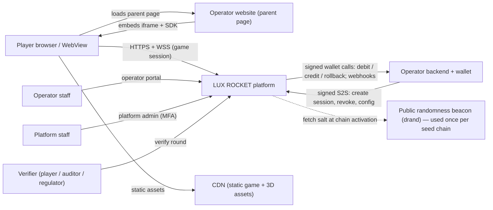
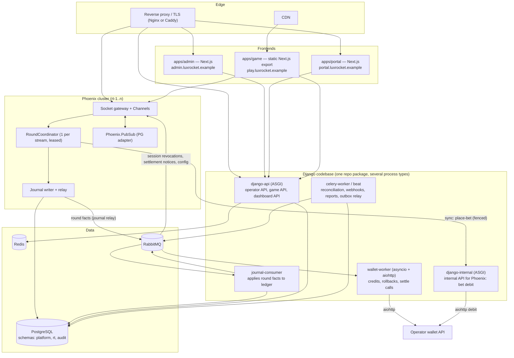
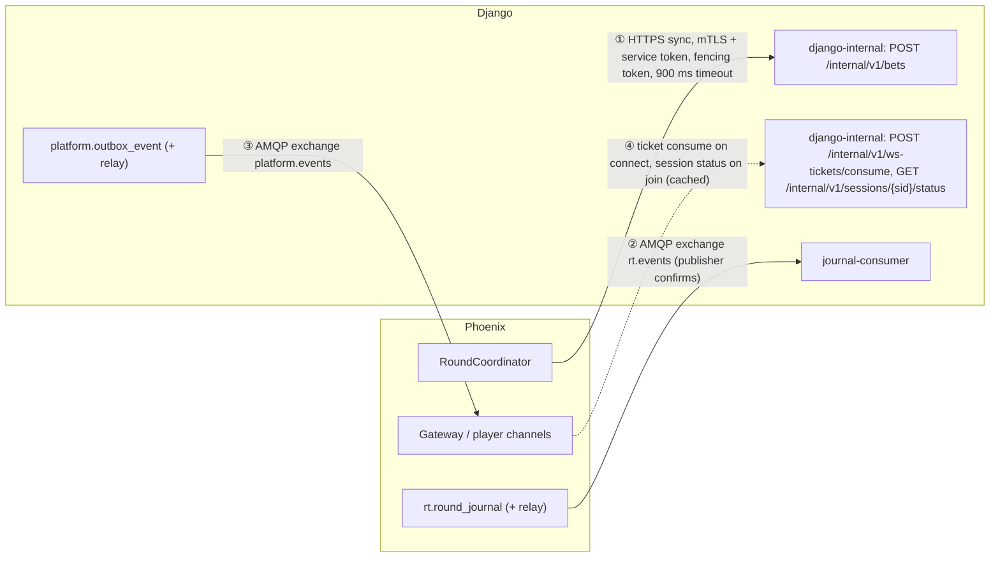
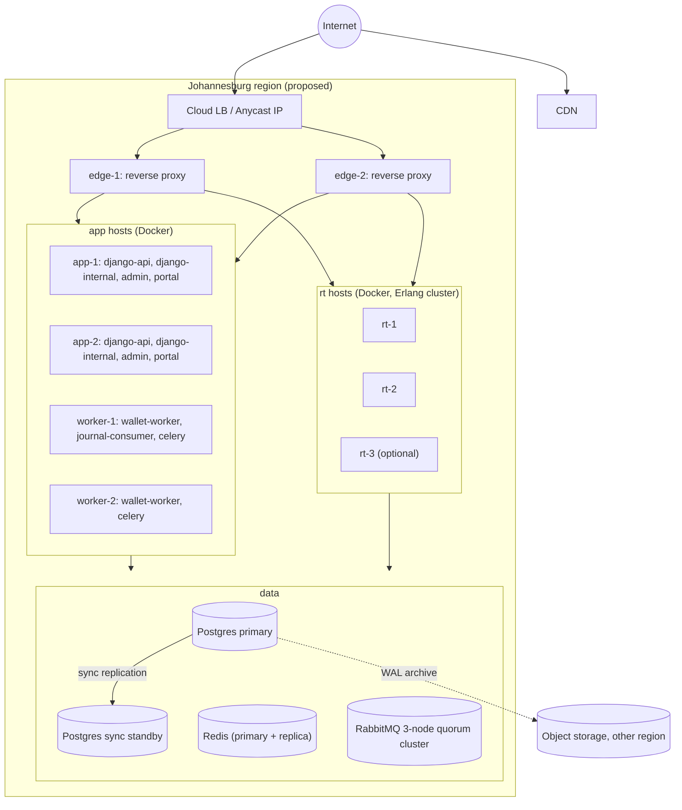

# 02 — System Architecture

## 1. Architectural principles

1. **One owner per fact.** Every piece of state has exactly one writer. Time-critical round facts → Phoenix. Money and business records → Django. Player identity and funds → operator.
2. **Durable before acknowledged.** No player-visible "accepted" message is sent for anything not yet durably recorded by its owner.
3. **Idempotent everywhere.** Every cross-process command carries a stable id; every consumer deduplicates.
4. **Uncertain ≠ failed.** A timeout produces an `UNKNOWN` state resolved by reconciliation.
5. **Deterministic presentation.** The flight is a pure function of `(launch_at, ruleset)`; clients render locally and only need correction, not streams.
6. **Few moving parts.** Each infrastructure component has a narrow, written justification (§7).

## 2. System context

## 3. Component architecture

### Process types (all containers)

| Process | Codebase | Purpose | Scales by |
|---------|----------|---------|-----------|
| `game` | apps/game | Static bundle on CDN; no server runtime | CDN |
| `admin`, `portal` | apps/admin, apps/portal | Next.js server (SSR for authenticated shells) | replicas |
| `django-api` | backend/ | Public operator API, game HTTP API, dashboard APIs | replicas |
| `django-internal` | backend/ | Internal API for Phoenix (bet placement with synchronous debit). Separate deployment so dashboard load cannot starve the bet path. | replicas |
| `wallet-worker` | backend/ | Async consumer executing credits, rollbacks, settle calls with per-operator concurrency | replicas |
| `journal-consumer` | backend/ | Consumes round facts; writes bets/settlements/ledger; emits wallet jobs | 1 active per stream partition |
| `celery-worker`, `celery-beat` | backend/ | Scheduled & background jobs, outbox relay, webhooks | replicas (beat: 1) |
| `rt` | realtime/ | Phoenix node: sockets, channels, coordinators, journal | nodes |

## 4. Django ⇄ Phoenix communication

| # | Channel | Direction | Semantics | Used for |
|---|---------|-----------|-----------|----------|
| ① | HTTPS (internal network, mTLS) | Phoenix → Django | Synchronous request/response, idempotent by `bet_id` | Place bet: validate session, limits, exposure; debit operator wallet; return `ACCEPTED`/`REJECTED`/`UNKNOWN`. |
| ② | RabbitMQ `rt.events` (topic) | Phoenix → Django | At-least-once, ordered per stream by `journal_seq`; consumer dedup by `event_id` | Bet admitted/excluded, cash-out accepted, round crashed/voided, outcome revealed. |
| ③ | RabbitMQ `platform.events` (topic) | Django → Phoenix | At-least-once, dedup by `event_id` | Session revoked, settlement confirmed/failed, balance updated, stream config/maintenance changes. |
| ④ | HTTPS | Phoenix → Django | Sync | WS ticket consumption on connect; session status check on channel join and every 60 s (cached 5 s). |

**Why ① is synchronous.** The player is waiting, the coordinator must know the result before launch, and the debit is the only operation whose latency gates the round. Making it asynchronous adds a queue hop and a correlation problem without removing the wait.

**Why ② is a journal, not an RPC.** Cash-out decisions must be durable in ≤ 20 ms and must not depend on Django being up. Phoenix commits the fact locally (Postgres `rt` schema), acknowledges the player, and the fact flows to Django asynchronously. If RabbitMQ or Django is down, facts accumulate in the journal and are replayed; Django's `journal-consumer` also runs a periodic catch-up scan directly against `rt.round_journal` (read-only role) to detect relay gaps.

Timeouts, retries and idempotency rules for each channel are in doc 06 §8.

## 5. Responsibility boundary (authoritative)

| Concern | Owner | Notes |
|---------|-------|-------|
| Round schedule, state transitions | **Phoenix** coordinator | Journaled. |
| Authoritative clock for a round | **Phoenix** coordinator node clock (NTP-disciplined) | All deadlines compared against coordinator receipt time. |
| Betting cut-off | **Phoenix** | `BETTING_OPEN` → `BETTING_CLOSED` at `close_at`. |
| Outcome generation | **Phoenix** (`Outcome` module + seed chain in `rt.seed_chain`) | Derived from committed seed chain; computed when the round is created. |
| Bet validation (session, limits, exposure, currency) | **Django** | In the internal place-bet call. |
| Operator wallet debit | **Django** (`django-internal`) | Synchronous within bet call. |
| Bet admission into a round | **Phoenix** | Admits only if Django returned `ACCEPTED` before `launch_at`; journals `BET_ADMITTED` or `BET_EXCLUDED`. |
| Cash-out acceptance (manual & auto) | **Phoenix** | Serialised in the coordinator with the crash; journaled before the player ack. |
| Payout amount | **Phoenix computes**, **Django recomputes and verifies** | Pure integer function; mismatch = critical alert, Django's value is not substituted silently. |
| Settlement initiation | **Django** (`journal-consumer`) | Triggered by journal facts. |
| Financial records (bets, wallet transactions, ledger, settlements) | **Django** only | `platform` schema. |
| Round finalisation (financial) | **Django** | `GameRound.settlement_status = SETTLED` when every bet is terminal. |
| Round finalisation (game) | **Phoenix** | `CRASHED` or `VOIDED` journal entry + seed reveal. |
| Session issuance & revocation | **Django** | Phoenix enforces. |
| Operator config, limits, rulesets | **Django** | Pushed to Phoenix as versioned snapshots; a round binds a ruleset version at creation. |

**Invariant:** no table is written by both runtimes. Enforced by database roles: `rt_writer` can only write `rt.*`; `platform_writer` can only write `platform.*`; Django has `rt_reader` (SELECT on `rt.*` except `rt.seed_chain`).

## 6. Deployment topology (reference, single region)

Detailed in doc 17. A managed Postgres offering is preferred over self-managed Patroni if one exists in the chosen region with synchronous standby support (OQ-05).

## 7. Infrastructure justification

| Component | Narrow job | What it MUST NOT be used for |
|-----------|------------|------------------------------|
| PostgreSQL | All durable state: financial records, round journal, config, audit. | — |
| Redis | Rate limiting, cached session status, cached operator config, cached round snapshots for HTTP, Celery result backend (optional). | Any record whose loss changes money or outcomes; single-use token enforcement; locks that guard financial writes. |
| RabbitMQ | Async delivery of journal facts and platform events; wallet job queues; webhooks; Celery broker. | A substitute for DB transactions; multiplier ticks; anything not reconstructible from Postgres. |
| Phoenix PubSub (PG/distributed Erlang) | Real-time fan-out between rt nodes. | Durable messaging. |
| aiohttp | Outbound HTTP to operator wallets/webhooks with pooled sessions. | Serving players; a second backend. |

## 8. Data ownership summary

| Data | Owner | Store | Durability |
|------|-------|-------|-----------|
| Operator, credentials (public keys), domains, config | Django | `platform` | Durable |
| Game, versions, rulesets, streams | Django | `platform` | Durable; snapshots pushed to Phoenix |
| Sessions, launch tokens | Django | `platform` | Durable (short-lived rows, pruned) |
| Round journal, seed chain, leases | Phoenix | `rt` | Durable, append-only (journal) |
| Bets, wallet transactions, ledger, settlements, refunds | Django | `platform` | Durable, append-only ledger |
| Audit events | Django (both runtimes emit) | `audit` (hash-chained) | Durable, append-only |
| Active round in-memory state | Phoenix coordinator | process memory | Ephemeral; reconstructible from journal |
| Rate-limit counters, caches | — | Redis | Ephemeral |
| Client animation state | Browser | memory | Ephemeral |

The four kinds of state the brief asks to distinguish:

1. **Authoritative game state** — the coordinator's in-memory state machine, *valid only while it holds the current lease*, and only to the extent it is reflected in the journal.
2. **Durable records** — `rt.round_journal` (game facts) and `platform.*` (money). Recovery always starts here.
3. **Ephemeral coordination state** — leases' in-memory copies, Redis caches, PubSub. Losable.
4. **Client animation state** — interpolated multiplier, camera, effects. Always subordinate to the latest snapshot.
