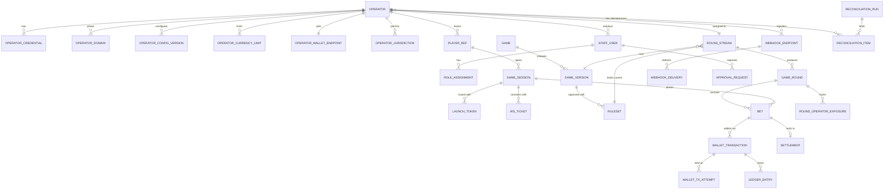
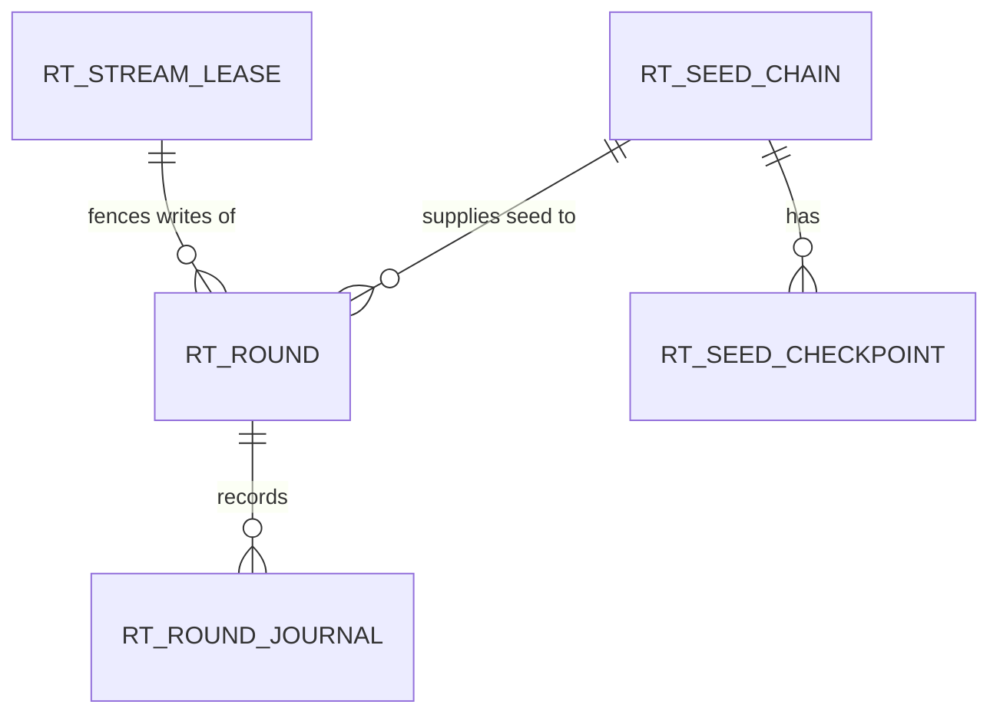
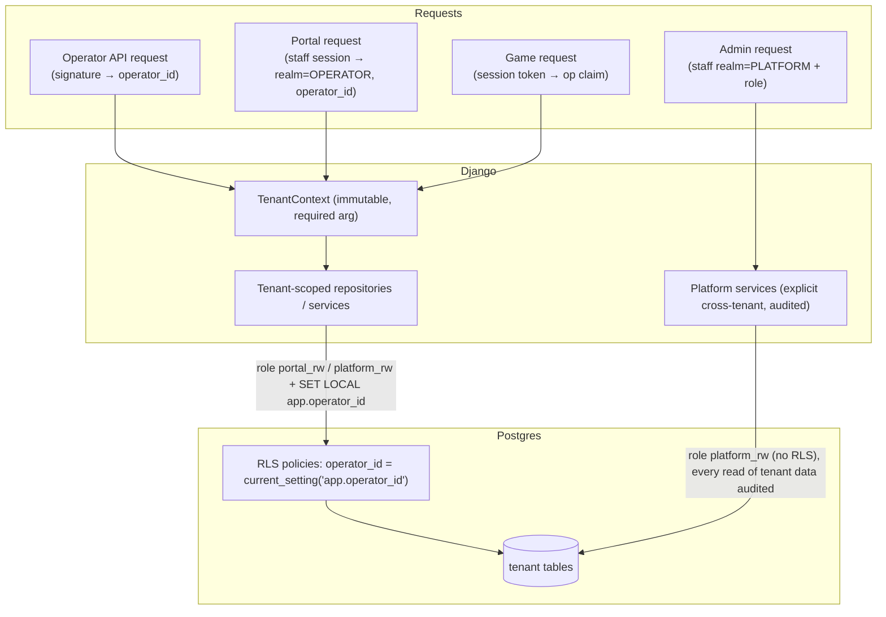

# 04 — Domain Model and Database

## 1. Storage layout

One PostgreSQL cluster (v16+), one database per environment, three schemas:

| Schema | Writer role | Reader roles | Contents |
|--------|-------------|--------------|----------|
| `platform` | `platform_rw` (Django) | `portal_rw` (RLS), `analytics_ro` | Operators, sessions, config, bets, wallet transactions, ledger, settlements, webhooks, outbox |
| `rt` | `rt_rw` (Phoenix) | `rt_reader` (Django; **no access** to `rt.seed_*`) | Leases, seed chains, rounds, round journal |
| `audit` | `audit_append` (INSERT only, both runtimes) | `auditor_ro` | Hash-chained audit events |

Sandbox and production are **separate deployments with separate databases**. No row ever mixes sandbox and real-money data.

Migrations: Django migrations own `platform` and `audit`; Ecto migrations own `rt`. CI fails if either touches the other's schema.

## 2. Money, multipliers and identifiers

| Concept | Representation |
|---------|----------------|
| Amount | `BIGINT amount_minor` + `CHAR(3) currency`. JSON: string (`"1250"`). |
| Currency precision | `platform.currency.exponent` (e.g. USD 2, ZAR 2, ZMW 2, BWP 2, MWK 2, MZN 2, ZWG 2 — verify each at onboarding, OQ-16). |
| Multiplier | `INT *_x10000` (10100 = 1.01×; 23456 = 2.3456×). One unit for every multiplier column. Crash points and auto targets: multiples of 100 (CHECK). Max 10 000× = 100 000 000 fits INT. |
| Rounding | Payout = `floor(stake_minor × multiplier_x10000 / 10000)`, then capped by `max_win_minor`. Always toward the house by < 1 minor unit; disclosed in rules. |
| IDs | UUIDv7 internally. Public ids are prefixed base32 of the UUID (`bet_01J…`). |
| Time | `timestamptz`, microsecond; coordinator times stored as received. |

## 3. Entity-relationship diagram

Phoenix-owned (`rt`) entities, linked by id only (no cross-schema FKs from `rt` to `platform`):

## 4. Entity catalogue

Columns are abbreviated; `id` is UUIDv7 PK unless stated; all tables have `created_at`. "Tenant" = carries `operator_id` and is subject to RLS for portal roles.

### 4.1 Platform identity & access

| Entity | Purpose | Key columns & constraints | Tenant | Lifecycle / retention | Class. |
|--------|---------|---------------------------|--------|----------------------|--------|
| `staff_user` | Platform & operator staff login (custom Django user) | `email` unique (citext), `realm` ∈ {PLATFORM, OPERATOR}, `operator_id` NULL iff realm=PLATFORM (CHECK), `password` (argon2), `mfa_required`, `is_active`, `last_login_at` | Operator realm rows: yes | Deactivate, never hard-delete (audit refs) | Confidential |
| `staff_mfa_device` | WebAuthn/TOTP devices | `user_id` FK, `kind`, `credential_id` unique, encrypted secret (TOTP) | via user | Revocable | Restricted |
| `role_assignment` | RBAC | `user_id`, `role`, `operator_id` NULL for platform; unique (`user_id`,`role`,`operator_id`) | yes | Audited grant/revoke | Internal |
| `approval_request` | Four-eyes for sensitive actions (ruleset release, adjustments, real-money enable, seed activation) | `action_type`, `payload` jsonb, `requested_by`, `approved_by` (≠ requested_by CHECK), `status`, `expires_at` | optional | Immutable after decision | Confidential |

### 4.2 Operators

| Entity | Purpose | Key columns & constraints | Lifecycle | Class. |
|--------|---------|---------------------------|-----------|--------|
| `operator` | Tenant root | `public_id` unique (`op_…`), `legal_name`, `status` ∈ {ONBOARDING, SANDBOX, LIVE, SUSPENDED, TERMINATED}, `real_money_enabled` bool (only via approval), `stream_id` FK, `contract_ref`, `revenue_share_bp` (commercial metadata) | Status transitions audited; never deleted | Confidential |
| `operator_credential` | API signing keys | `operator_id`, `kid` unique, `algorithm` ∈ {ED25519, HMAC_SHA256}, `public_key` (Ed25519) or `secret_ciphertext`+`dek_id` (HMAC), `status` ∈ {ACTIVE, ROTATING, REVOKED}, `not_after`; partial unique: ≤ 2 ACTIVE/ROTATING per operator | Rotation overlap ≤ 14 days | Restricted |
| `operator_domain` | Allowed embedding/parent origins | `operator_id`, `origin` (scheme+host+port, normalised), unique (`operator_id`,`origin`); `verified_at` | Change → CSP cache bust | Internal |
| `operator_config_version` | Versioned operator-editable & platform-set settings | `operator_id`, `version` (unique per operator), `settings` jsonb (schema-validated), `effective_from`, `created_by`; only newest effective row applies | Append-only | Internal |
| `operator_currency_limit` | Per-currency limits | unique (`operator_id`,`currency`); `min_stake_minor`, `max_stake_minor`, `max_win_minor`, `round_exposure_limit_minor`; CHECK min ≤ max, all > 0 | Versioned via audit | Internal |
| `operator_wallet_endpoint` | Wallet API settings | `operator_id` unique, `base_url`, `auth_scheme`, `timeout_ms` (≤ 900 debit), `max_concurrency`, `send_settle_on_loss` bool, `supports_status_query` bool | — | Confidential |
| `market` | Platform-level country registry (ADR-026) | `country_code` PK (ISO-3166-1 alpha-2), `status` ∈ {DISABLED, SANDBOX, REAL}, `requires_second_approver` bool, `evidence_ref`, `changed_by` (must hold PLAT_OWNER — enforced in service and by DB trigger checking role), `changed_at`; history in audit | Never deleted | Internal |
| `operator_jurisdiction` | Permitted player countries (subset of enabled markets) | unique (`operator_id`,`country_code`) | — | Internal |
| `currency` | Currency registry | `code` PK, `exponent`, `enabled` | — | Public |

### 4.3 Players and sessions

| Entity | Purpose | Key columns & constraints | Lifecycle | Class. |
|--------|---------|---------------------------|-----------|--------|
| `player_ref` | Pseudonymous operator player | unique (`operator_id`,`external_player_id`); `display_alias` (optional, masked), `country_code`, `first_seen_at`, `rg_flags` jsonb | Retained with financial records; no PII by contract | Confidential |
| `game_session` | One launch | `public_id` (`ses_…`), `operator_id`, `player_ref_id`, `currency`, `locale`, `stream_id`, `mode` ∈ {SANDBOX, REAL}, `operator_session_token_ct` (opaque operator token for wallet calls, encrypted), `status` ∈ {PENDING, ACTIVE, EXPIRED, REVOKED}, `session_version` int, `expires_at`, `revoked_reason`; index (`operator_id`,`player_ref_id`,`status`) | 24 h max; rows kept 13 months | Confidential |
| `launch_token` | One-time launch credential | `token_hash` unique (SHA-256), `session_id`, `expires_at` (≤ 60 s), `used_at`; single-use via `UPDATE … WHERE used_at IS NULL AND expires_at > now()` | Pruned after 7 days | Restricted |
| `ws_ticket` | One-time WS connect credential | same pattern, ≤ 30 s | Pruned after 1 day | Restricted |

### 4.4 Games and rounds

| Entity | Purpose | Key columns & constraints | Lifecycle | Class. |
|--------|---------|---------------------------|-----------|--------|
| `game` | Product (e.g. `lux-rocket`) | `slug` unique | — | Public |
| `game_version` | Deployable client+server version | unique (`game_id`,`semver`); `status` ∈ {DRAFT, CERTIFYING, APPROVED, ACTIVE, RETIRED}; `client_asset_manifest` (hash), `server_build` | Immutable once APPROVED | Internal |
| `ruleset` | Versioned math & rules config | unique (`game_version_id`,`version`); `params` jsonb: `house_edge_bp`, `curve_lambda_per_ms`, `max_multiplier_x10000`, `betting_window_ms`, `close_grace_ms`, `cooldown_ms`, `panels`; `params_hash`; `status`; `certificate_ref` | Immutable once APPROVED; release requires approval_request | Internal |
| `round_stream` | Continuous sequence of shared rounds | `slug` unique, `game_version_id`, `ruleset_id`, `mode`, `status` ∈ {RUNNING, DRAINING, PAUSED, MAINTENANCE}; ruleset changes apply at next round boundary | — | Internal |
| `game_round` | Django **projection** of an `rt.round` | `id` = rt round id, `stream_id`, `ruleset_id`, `number` (per stream, unique with stream), `state`, `launch_at`, `crash_x10000` (NULL until crash), `seed_revealed`, `settlement_status` ∈ {OPEN, SETTLING, SETTLED, NEEDS_ATTENTION}, `last_journal_seq` | Written only by journal-consumer | Internal (public after crash) |
| `round_operator_exposure` | Atomic exposure counter per round × operator × currency | PK (`round_id`,`operator_id`,`currency`), `exposure_minor`, `limit_minor`; updated with `UPDATE … SET exposure=exposure+$x WHERE exposure+$x <= limit_minor` | Pruned after 90 days | Internal |

`RoundVerificationRecord` from the brief is folded into `rt.round` (canonical) and the `game_round` projection; verification is served from those.

### 4.5 Bets, transactions, ledger

| Entity | Purpose | Key columns & constraints | Lifecycle | Class. |
|--------|---------|---------------------------|-----------|--------|
| `bet` | One stake on one panel in one round | `public_id` (`bet_…`), `operator_id`, `session_id`, `player_ref_id`, `round_id`, `panel` smallint (0..N-1), `client_command_id` uuid, `stake_minor`, `currency`, `auto_cashout_x10000` NULL, `max_win_minor` (snapshot), `status` (doc 08 §3), `cashout_x10000`, `payout_minor`, `admitted_at`, `cashed_out_at`. **Unique (`round_id`,`operator_id`,`player_ref_id`,`panel`)** — one bet per panel per player per round across tabs/sessions; **unique (`round_id`,`session_id`,`client_command_id`)**. Index (`operator_id`,`created_at`), (`round_id`,`status`). Range-partitioned monthly by `round_id` (UUIDv7 is time-ordered, so the partition key is part of both unique constraints, as Postgres requires). | Retained ≥ jurisdiction minimum (OQ-08, default 7 y) | Confidential |
| `wallet_transaction` | One logical wallet command | `public_id` = **`transaction_id` sent to operator** (`tx_…`), `operator_id`, `bet_id`, `type` ∈ {DEBIT, CREDIT, ROLLBACK, SETTLE, ADJUSTMENT_CREDIT}, `amount_minor`, `currency`, `ref_transaction_id` (for ROLLBACK → DEBIT), `status` ∈ {PENDING, SUCCEEDED, FAILED, UNKNOWN, ABANDONED}, `operator_reference`, `attempt_count`, `next_attempt_at`. **Unique (`bet_id`,`type`)** for DEBIT/CREDIT/ROLLBACK/SETTLE (partial) — makes a second credit for the same bet impossible. Range-partitioned by `bet_id` (UUIDv7) so the unique key contains the partition key. | Retained 7 y | Confidential |
| `wallet_tx_attempt` | Immutable record of each HTTP attempt | `wallet_transaction_id`, `attempt_no`, `request_digest`, `http_status`, `operator_code`, `latency_ms`, `outcome` ∈ {OK, REJECTED, TIMEOUT, NETWORK, 5XX, INVALID}, `response_excerpt` (redacted) | Append-only; 2 y | Confidential |
| `ledger_entry` | Double-entry postings | `journal_id` (groups balanced entries), `operator_id`, `account` (e.g. `player_stakes`, `player_wins`, `refunds`, `operator_wallet`), `amount_minor` (signed), `currency`, `bet_id`, `wallet_transaction_id`; DB trigger: SUM(amount) per `journal_id` = 0 (deferred constraint trigger); UPDATE/DELETE revoked from all roles | Append-only, 7 y | Confidential |
| `settlement` | Terminal financial outcome of a bet | `bet_id` unique, `outcome` ∈ {WIN, LOSS, REFUND}, `payout_minor`, `multiplier_x10000`, `status` ∈ {PENDING, CONFIRMED, FAILED_NEEDS_ATTENTION}, `confirmed_at` | 7 y | Confidential |

The brief's `Refund` entity is represented by `wallet_transaction(type=ROLLBACK)` + `settlement(outcome=REFUND)`. `BetPanel/BetSlot` is the `panel` column; panels have no independent lifecycle beyond the bet.

### 4.6 Integration plumbing

| Entity | Purpose | Key columns | Retention |
|--------|---------|-------------|-----------|
| `webhook_endpoint` | Operator webhook targets | `operator_id`, `url`, `event_types[]`, `status`, signing `kid` | Active life |
| `webhook_delivery` | Delivery log | `endpoint_id`, `event_id`, `attempt`, `status`, `http_status`, `next_attempt_at`; unique (`endpoint_id`,`event_id`,`attempt`) | 90 days |
| `outbox_event` | Transactional outbox | `event_id` uuid unique, `aggregate`, `aggregate_id`, `type`, `payload`, `operator_id` NULL, `published_at` NULL; index on `published_at IS NULL` | 14 days after publish |
| `processed_event` | Consumer inbox dedup | PK (`consumer`,`event_id`) | 30 days |
| `reconciliation_run` / `reconciliation_item` | Reconciliation results | run: `kind`, `period`, `operator_id`; item: `type` (e.g. `DEBIT_WITHOUT_ADMISSION`, `CREDIT_MISSING`, `AMOUNT_MISMATCH`), `bet_id`, `status` ∈ {OPEN, AUTO_RESOLVED, RESOLVED, WAIVED}, `resolution_note` | 7 y |
| `fx_rate` | Indicative reporting rates | (`date`,`base`,`quote`) PK | 7 y |
| `operator_daily_stats` | Pre-aggregated reporting | (`operator_id`,`date`,`currency`) PK; turnover, wins, refunds, ggr, bets, rounds, unique players | 7 y |

### 4.7 Audit

`audit.audit_event`: `seq` bigserial, `occurred_at`, `actor_type` (STAFF/OPERATOR_API/SERVICE/SYSTEM), `actor_id`, `operator_id` NULL, `action`, `target_type`, `target_id`, `before`/`after` (redacted jsonb), `ip`, `user_agent_hash`, `correlation_id`, `prev_hash`, `hash` = SHA-256(prev_hash ‖ canonical_json(row)). INSERT-only role; daily anchor hash exported to WORM object storage. Brief's `AdminAction` = audit events with `actor_type=STAFF` (+ `approval_request` when four-eyes applies).

### 4.8 Real-time schema (`rt`, Phoenix-owned)

| Entity | Purpose | Key columns & constraints |
|--------|---------|---------------------------|
| `rt.stream_lease` | Coordinator ownership | `stream_id` PK, `holder` (node+boot id), `fencing_token` bigint, `expires_at` |
| `rt.seed_chain` | Committed chain per stream | `chain_id` PK, `stream_id`, `length`, `terminal_hash` (public), `salt` (public, NULL until fixed), `salt_source` (e.g. `drand:quicknet:R`), `commitment_signature`, `root_seed_ct` + `dek_id` (encrypted), `next_index`, `status` ∈ {GENERATED, COMMITTED, SALTED, ACTIVE, EXHAUSTED, REVOKED} |
| `rt.seed_checkpoint` | Encrypted seeds every 10 000 indexes for O(10⁴) derivation | (`chain_id`,`index`) PK, `seed_ct` |
| `rt.round` | Canonical round record | `round_id` PK, `stream_id`, `number` unique per stream, `chain_id`, `chain_index` unique per chain, `ruleset_id`, `ruleset_hash`, `state`, `opens_at`, `close_at`, `launch_at`, `crash_at`, `crash_x10000` (**NULL until crash**), `seed_hex` (**NULL until crash/void**), `commitment` (= previous round's seed or terminal hash), `fencing_token` |
| `rt.round_journal` | Append-only facts | `journal_id` bigserial, `stream_id`, `round_id`, `stream_seq` (gapless per stream, unique (`stream_id`,`stream_seq`)), `event_id` uuid unique, `type`, `payload` jsonb, `fencing_token`, `recorded_at`, `relayed_at` NULL; partitioned monthly |

Crash point and seed are **never written before the crash**. Pre-crash the database contains only the commitment. With void-on-malfunction (ADR-005) a recovering coordinator never needs the crash point of an interrupted round; it re-derives the seed from the chain to reveal it after voiding.

## 5. Transaction boundaries

| Operation | Single DB transaction contains |
|-----------|-------------------------------|
| Create session | `player_ref` upsert, `game_session`, `launch_token`, audit event |
| Exchange launch token | `launch_token.used_at` (conditional update), `game_session.status=ACTIVE` |
| Place bet (phase 1) | `bet(PENDING_DEBIT)`, `wallet_transaction(DEBIT, PENDING)`, exposure increment |
| Place bet (phase 2, after HTTP) | `wallet_transaction` status, `wallet_tx_attempt`, `bet` status, ledger postings (if success), outbox `bet.debited`/`bet.rejected` |
| Apply journal fact | `processed_event` insert, bet/settlement/round projection updates, ledger postings, new `wallet_transaction(CREDIT/ROLLBACK, PENDING)`, outbox |
| Wallet worker result | `wallet_transaction` status, `wallet_tx_attempt`, `settlement` status, ledger postings, outbox `settlement.confirmed` |

**No HTTP call is ever made inside an open DB transaction.** The bet path is two short transactions around the HTTP debit.

## 6. Tenant isolation

Rules:
1. Operator identity is **derived from the credential**, never from a request parameter. A request body naming another `operator_id` is ignored/rejected.
2. Object lookups by public id are always `WHERE operator_id = ctx.operator_id AND public_id = $id`; mismatch → `404`, never `403` (no existence oracle).
3. The portal's DB role has RLS `FORCE`d on all tenant tables; even a bug in scoping cannot read foreign rows.
4. Exports/reports run with the same context and role.
5. Caches are keyed by `operator_id` first.
6. Platform admins reading tenant data generate audit events (who looked at what).

## 7. Volume estimates (for partitioning, not capacity claims)

Assume one stream, ~27 s per round cycle (doc 07 §5) → ≈ 3 200 rounds/day. At 3 000 bets per round (illustrative), ≈ 9.6 M bets/day and ≈ 25 M wallet transactions/day. Hence monthly range partitioning (by a UUIDv7 key or timestamp that is included in every unique constraint) for `bet`, `wallet_transaction`, `wallet_tx_attempt`, `ledger_entry`, `rt.round_journal`; partition detach/archive to object storage per retention policy.
