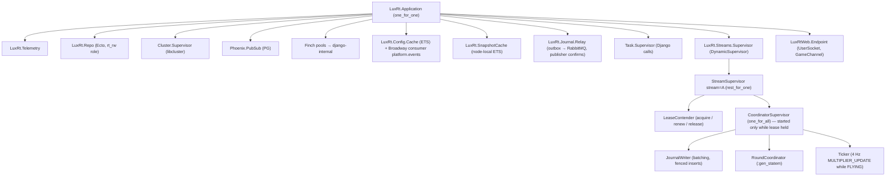
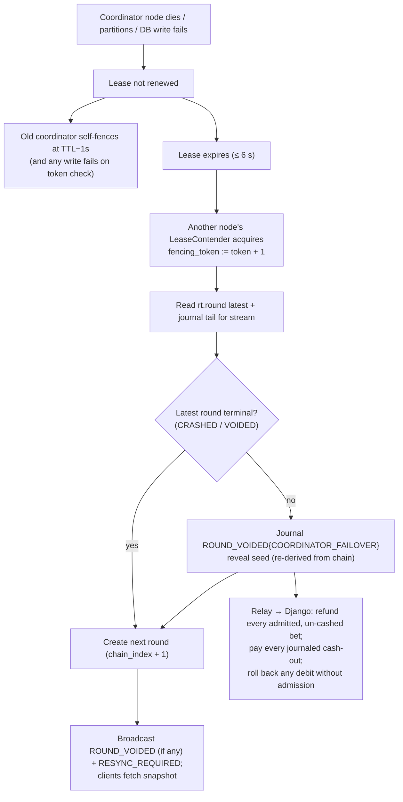

# 06 — Elixir / Phoenix Real-Time Specification

## 1. Responsibilities (and non-responsibilities)

Phoenix (`realtime/`, OTP app `:lux_rt`) **does**:
- Terminate player WebSockets, authenticate them, deliver events.
- Run exactly one `RoundCoordinator` per round stream (leased, fenced).
- Decide betting cut-off, bet admission, launch, cash-out acceptance (manual & auto), crash, void.
- Journal every round fact to `rt.round_journal` and relay it to RabbitMQ.
- Derive outcomes from the committed seed chain.

Phoenix **does not**: call operator wallets, write financial tables, store player data beyond session claims in memory, expose a general business API, or make limit/exposure decisions.

## 2. Supervision tree



- Every node runs a `StreamSupervisor` (and `LeaseContender`) for every enabled stream; only the lease holder starts `CoordinatorSupervisor`.
- `one_for_all` under `CoordinatorSupervisor`: if the journal writer or coordinator dies, both restart **and the lease is re-validated** before resuming; a restart mid-round results in void (§7).
- Coordinators are found via `:pg` group `{:coordinator, stream_id}`. Duplicates during partitions are harmless: a coordinator without the current fencing token cannot journal anything and rejects commands with `COORDINATOR_UNAVAILABLE` (client retries).

## 3. Lease and fencing (ADR-004)

| Parameter | Default |
|-----------|---------|
| Lease TTL | 6 000 ms |
| Renew interval | 2 000 ms |
| Self-fence deadline | stop acting at `local_monotonic(acquired) + TTL − 1 000 ms` without a successful renewal |
| Contender poll | 1 000 ms, plus immediate attempt on `lease_released` PubSub message |

Fenced journal insert (single statement):
```sql
INSERT INTO rt.round_journal (stream_id, round_id, stream_seq, event_id, type, payload, fencing_token, recorded_at)
SELECT $1, $2, $3, $4, $5, $6, $7, $8
FROM rt.stream_lease l
WHERE l.stream_id = $1 AND l.fencing_token = $7 AND l.holder = $9;
-- 0 rows inserted ⇒ lease lost ⇒ coordinator halts immediately.
```
Batch inserts use the same predicate with `unnest()`.

## 4. Round lifecycle state machine

```mermaid
stateDiagram-v2
  [*] --> PENDING: create round (bind ruleset, chain_index, commitment)
  PENDING --> BETTING_OPEN: opens_at
  BETTING_OPEN --> BETTING_CLOSED: close_at
  BETTING_CLOSED --> FLYING: launch_at [admission barrier flushed]
  FLYING --> CRASHED: crash_at + crash_grace [all stamped cash-outs processed]
  CRASHED --> [*]: seed revealed; next round created
  PENDING --> VOIDED: failover / fault / maintenance
  BETTING_OPEN --> VOIDED: failover / fault / maintenance
  BETTING_CLOSED --> VOIDED: failover / fault
  FLYING --> VOIDED: failover / fault
  VOIDED --> [*]: seed revealed; refunds via Django
```



| State | Entry actions (journal first, then broadcast) | Accepts | Exit trigger |
|-------|-----------------------------------------------|---------|--------------|
| `PENDING` | Insert `rt.round`; compute `crash_x100` **in memory only**; journal `ROUND_CREATED{commitment, ruleset_hash}` | — | `opens_at` (= previous crash + cooldown) |
| `BETTING_OPEN` | journal `ROUND_OPENED`; broadcast `ROUND_OPEN` | `PLACE_BET` (stamp < `close_at`) | `close_at = opens_at + betting_window_ms` (default 7 000) |
| `BETTING_CLOSED` | journal `BETTING_CLOSED`; broadcast | Django results for in-flight bets | `launch_at = close_at + close_grace_ms` (default 1 000) |
| `FLYING` | barrier-flush admissions; journal `BET_EXCLUDED` for every still-pending bet; journal `ROUND_LAUNCHED{launch_at}`; broadcast `ROCKET_LAUNCHED` | `CASH_OUT` (stamp < `crash_at`); auto cash-outs at target crossing | `crash_at = launch_at + t(crash_x100)`, finalised after `crash_grace_ms` (default 50) |
| `CRASHED` | journal `ROUND_CRASHED{crash_x100, crash_at, seed, salt}`; update `rt.round`; broadcast `ROUND_CRASHED` | — | create next round immediately; `opens_at = crash_at + cooldown_ms` (default 2 000) |
| `VOIDED` | journal `ROUND_VOIDED{reason, seed}`; broadcast `ROUND_VOIDED` | — | create next round |

Timing uses `System.monotonic_time/1` internally; published timestamps are `System.os_time(:millisecond)` captured at the same instant (offset fixed per round to avoid NTP slew mid-round).

Instant crash (`crash_x100 = 100`): `crash_at = launch_at`; the round goes `FLYING → CRASHED` with no cash-out opportunity. This is a disclosed rule (doc 07 §4).

## 5. Command handling inside the coordinator

### 5.1 Time stamping
The **gateway channel process** stamps each command with `received_at` (os time, ms) and monotonic time when the frame is decoded. The coordinator compares this stamp — never a client timestamp — against deadlines. Cluster clock skew is monitored (§9); if any node's offset exceeds 5 ms the node is removed from the load balancer.

`crash_grace_ms` gives in-flight commands stamped before `crash_at` time to reach the coordinator. Commands arriving after the crash is finalised are rejected (`ROUND_ENDED`) whatever their stamp, and counted (`late_after_finalise_total`) — a non-zero rate means the grace is too small.

### 5.2 PLACE_BET
1. Validate envelope, panel index, stake format (syntax only — business validation is Django's).
2. Reject unless state is `BETTING_OPEN` and `received_at < close_at`.
3. Dedupe on `(session_id, panel)` and `client_command_id` in coordinator memory; a duplicate returns the current state of the existing bet.
4. Record `pending` in memory; spawn a supervised `Task` → `POST /internal/v1/bets` with `fencing_token`, `round_id`, `debit_deadline = launch_at − 50 ms`, HTTP timeout `min(900, launch_at − now − 50)` ms.
5. On result message:
   - `ACCEPTED` and `now < launch_at` → enqueue `BET_ADMITTED` to JournalWriter; on flush → push `BET_ACCEPTED` to the player.
   - `ACCEPTED` and `now ≥ launch_at` → already excluded at launch (§4); push `BET_REJECTED{reason: LATE, refund: PENDING}`.
   - `REJECTED` → push `BET_REJECTED{reason}`.
   - `UNKNOWN` / task timeout → push `BET_REJECTED{reason: UNCERTAIN, refund: PENDING}`; the exclusion fact (journaled at launch) guarantees Django rolls back if the debit actually succeeded.

### 5.3 CASH_OUT (manual)
Within the single coordinator process (therefore serialised with the crash):
1. Bet exists, admitted, owned by session, not already cashed → else `CASHOUT_REJECTED`.
2. State `FLYING` and `received_at < crash_at` → else `CASHOUT_REJECTED{ROUND_ENDED}`.
3. `cashout_x100 = floor100(m(received_at − launch_at))` (always ≤ `crash_x100 − 1`, doc 07 §3).
4. `payout_minor = min(floor(stake × cashout_x100 / 100), max_win_minor)`.
5. Mark cashed in memory (prevents double cash-out), enqueue `CASHOUT_ACCEPTED` journal entry; on flush → push `CASHOUT_ACCEPTED{bet_id, cashout_x100, payout_minor}`. If flush fails, the coordinator halts; the round is voided and the bet refunded — the player never received an acceptance.

### 5.4 Auto cash-out
- Every admitted bet gets an effective target `k_eff = min(auto_cashout_x100 or ∞, floor(100·max_win/stake), M)` (doc 07 §4); bets with a finite `k_eff` are kept in a `:gb_trees` keyed by it. Pricing uses the ruleset's tabulated curve (doc 07 §3).
- If `crash_x100 = M` the round ends with `end_reason: MAX_MULTIPLIER` and all still-active bets are cashed at M before `ROUND_CRASHED` is journaled.
- The coordinator schedules a timer at the **curve crossing time of the next target**, `t = ln(target/100)/λ`, never earlier.
- On each timer: all bets with `target ≤ floor100(m(now))` **and** `target ≤ crash_x100` are cashed at their *target* multiplier, journaled in one batch, then pushed.
- Bets with `target > crash_x100` are never touched before the crash.

**Information-leak rule.** No action whose timing or content depends on the crash point may become externally observable before the curve reaches the corresponding multiplier. Concretely: auto cash-outs are journaled and relayed only at crossing time (otherwise an early wallet credit for a 10× target would reveal "crash ≥ 10×" to anyone watching the operator wallet); internal logs never contain `crash_x100` before `ROUND_CRASHED`.

### 5.5 Journal writer
- Batches up to 200 entries or 10 ms, whichever first; one fenced multi-row insert; replies `{:flushed, event_ids}`.
- `stream_seq` assigned by the writer, gapless (resumes from `max(stream_seq)` at start).
- Barrier API: `flush_now/0` used before `ROUND_LAUNCHED` and before `ROUND_CRASHED`.
- On DB error: retry for at most 500 ms, then report failure → coordinator halts (enters local `FAULT`, rejects commands, stops broadcasting multiplier, emits `RESYNC_REQUIRED`), and the stream supervisor releases nothing — the lease simply expires or the same node re-acquires and voids.

### 5.6 Journal relay
A per-node process selects unrelayed entries (`relayed_at IS NULL`, ordered by `stream_seq`, `FOR UPDATE SKIP LOCKED`), publishes to exchange `rt.events` with routing key `stream.{id}.{type}`, waits for publisher confirms, then sets `relayed_at`. At-least-once; Django deduplicates by `event_id`.

## 6. Fan-out and snapshots

| Topic | Members | Content |
|-------|---------|---------|
| `stream:{stream_id}` | all players on the stream | public round events, ticks, aggregate stats |
| `session:{session_id}` (internal PubSub, subscribed by the channel process) | one player's sockets | bet/cash-out/settlement/session events |

- Coordinator broadcasts once per event per node (PubSub), channel processes push pre-encoded frames (`Phoenix.Socket.Broadcast` fastlane).
- Every public broadcast also refreshes `SnapshotCache` on every node; joins and resyncs read node-local ETS — **no coordinator call for public state**.
- Player-specific state on join: one `GenServer.call` to the coordinator (`player_view(session_id)`, 200 ms timeout), falling back to Django `GET /game/v1/me/bets?round=` on timeout. Reconnect-storm behaviour is a named load-test scenario.
- Ticks: 4 Hz `MULTIPLIER_UPDATE` while FLYING, carrying `{elapsed_ms, multiplier_x100}` for client correction.
- "Players online" / "bets this round" are **aggregates** broadcast at 1 Hz, not Phoenix Presence (Presence diff traffic scales O(joins × nodes)).

## 7. Failure handling and recovery



| Failure | Behaviour | Player experience |
|---------|-----------|-------------------|
| Gateway node dies | Sockets reconnect to other nodes; snapshot resync | Brief "Reconnecting…"; bets unaffected |
| Coordinator node dies mid-round | Void after ≤ ~7 s; refunds | "Round cancelled — stakes returned" |
| Postgres unavailable | Coordinator halts at first failed flush; stream paused; lease cannot renew | "Game temporarily unavailable"; void on recovery |
| Django internal API down | New bets rejected `SERVICE_UNAVAILABLE`; flights and cash-outs continue | Can't bet; active bets unaffected |
| RabbitMQ down | Journal accumulates `relayed_at IS NULL`; settlement delayed; cash-outs still accepted | Win shown as "crediting…" longer |
| Redis down | Rate limits fall back to in-node limits; session-status cache misses go to Django | None/minor |
| Planned deploy | Node drains: coordinator releases lease **at round boundary**; sockets get `SERVER_DRAINING` + reconnect hint | No void; seamless |

Void rate is a top-level SLO metric; target ≈ 0 outside incidents.

## 8. Django interaction contract (from Phoenix side)

| Call | Timeout | Retries | Idempotency | On failure |
|------|---------|---------|-------------|-----------|
| `POST /internal/v1/bets` | `min(900, launch_at − now − 50)` ms | **none** (deadline-bound) | `(round_id, session_id, client_command_id)`; Django replays prior result | Treat as `UNKNOWN` |
| `POST /internal/v1/ws-tickets/consume` | 300 ms | 1 retry on connect error | single-use ticket | Reject socket connect |
| `GET /internal/v1/sessions/{sid}/status` | 300 ms | 1 | n/a | Use cached status ≤ 30 s old, else disconnect |
| Config snapshot fetch | 1 s | backoff | versioned | Keep last known config; stream refuses to start without one |

Ordering: all `rt.events` for a stream carry `stream_seq`; Django's journal-consumer is a single active consumer per stream queue and applies in order, buffering out-of-order arrivals (possible after relay retries) until gaps fill, with a gap-timeout that triggers a direct catch-up read from `rt.round_journal`.

Session revocation: Django publishes `session.revoked{sid, sv}` on `platform.events`; every node's consumer broadcasts to `session:{sid}`; channel processes push `SESSION_REVOKED` and close within ~1 s. Active bets of a revoked session are **not** cancelled (they're already debited); cash-outs from that session are rejected, auto cash-outs still execute (OQ-21: confirm operator expectation).

Service auth: mTLS (private CA) + `Authorization: Bearer <service token>` with audience `django-internal`, rotated quarterly; Django also validates `fencing_token ≥ max_seen[stream_id]` on bet calls.

## 9. Observability hooks
`:telemetry` events for: socket connects/disconnects, join latency, command latency (stamp→decision), journal flush latency & batch size, lease renew latency/failures, coordinator mailbox length, auto cash-out batch size, tick fan-out time, relay lag (now − recorded_at of oldest unrelayed), node clock offset (vs. chrony), late-after-finalise count, void count. Exported via PromEx/Prometheus (doc 17).

## 10. Coding standards
Elixir 1.17+/OTP 27+, Phoenix 1.7+ (pin exact versions at scaffold time), `mix format`, Credo strict, Dialyzer on CI, `StreamData` property tests for the outcome function and state machine.
