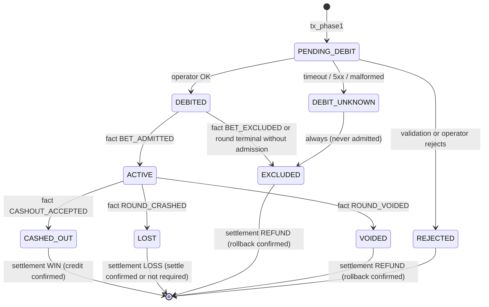
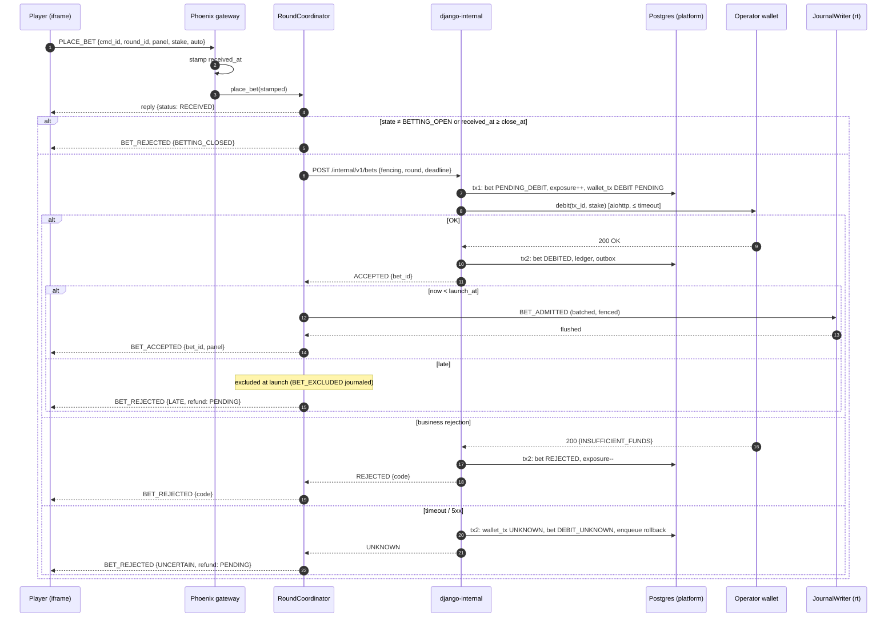
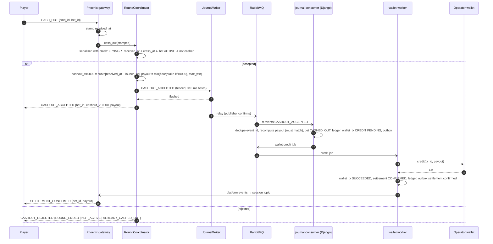
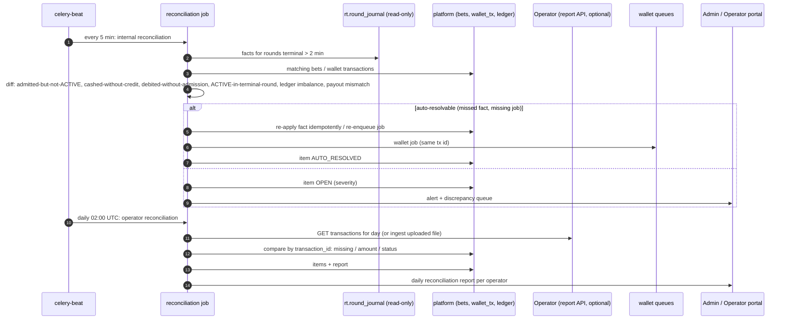

# 08 — Betting, Wallet and Settlement

## 1. Two-panel model

- Each session has `panels = ruleset.panels` (default 2) independent panels, indexed 0..N−1.
- **At most one bet per panel per player per round** (DB unique constraint across sessions/tabs).
- Per-panel state: stake, `bet_id`, acceptance status, `auto_cashout_x10000`, cash-out request state, confirmed cash-out (`cashout_x10000`, `payout_minor`), potential return (display only), settlement status, error/recovery state.
- Panels share the round and crash point; nothing else. One panel's cash-out, rejection or error never changes the other's state.
- Auto cash-out target is fixed at placement (v1). Changing it mid-flight is excluded to avoid a race with the coordinator's auto timer (OQ-22).
- No autoplay/auto-bet in v1 (responsible-gambling concern; several regulators restrict autoplay; OQ-23).
- **Bet for next round**: if the player presses BET while a round is flying, the panel enters `QUEUED` client-side and sends `PLACE_BET` when `ROUND_OPEN` arrives. Nothing is reserved server-side.

### 1.1 Client panel state machine

```mermaid
stateDiagram-v2
  [*] --> IDLE
  IDLE --> QUEUED: press BET while round not open
  QUEUED --> IDLE: press CANCEL
  QUEUED --> PLACING: ROUND_OPEN → send PLACE_BET
  IDLE --> PLACING: press BET during BETTING_OPEN
  PLACING --> PLACED: BET_ACCEPTED
  PLACING --> REJECTED: BET_REJECTED
  PLACED --> ACTIVE: ROCKET_LAUNCHED
  ACTIVE --> CASHING_OUT: press CASH OUT
  ACTIVE --> CASHED_OUT: CASHOUT_ACCEPTED (auto)
  CASHING_OUT --> CASHED_OUT: CASHOUT_ACCEPTED
  CASHING_OUT --> LOST: CASHOUT_REJECTED(ROUND_ENDED) / ROUND_CRASHED
  CASHING_OUT --> ACTIVE: CASHOUT_REJECTED(retryable)
  ACTIVE --> LOST: ROUND_CRASHED
  CASHED_OUT --> SETTLED: SETTLEMENT_CONFIRMED
  PLACED --> REFUNDING: ROUND_VOIDED / BET_EXCLUDED
  ACTIVE --> REFUNDING: ROUND_VOIDED
  REFUNDING --> REFUNDED: SETTLEMENT_CONFIRMED(refund)
  REJECTED --> IDLE: next ROUND_OPEN or dismiss
  LOST --> IDLE: next ROUND_OPEN
  SETTLED --> IDLE: next ROUND_OPEN
  REFUNDED --> IDLE: next ROUND_OPEN
  note right of PLACING: Any state → RECOVERING on disconnect;<br/>RECOVERING → state from ROUND_SNAPSHOT.player_bets
```

Rules: buttons are disabled while a command is in flight; each user intent gets one `client_command_id` (UUIDv7) reused across retries; the UI never shows "Won" before `CASHOUT_ACCEPTED`, and shows "Crediting…" until `SETTLEMENT_CONFIRMED`.

## 2. Wallet model

Seamless wallet (ADR-007). Operations against the operator (contract in doc 09 §6):

| Operation | When | Amount | Retry? |
|-----------|------|--------|--------|
| `debit` | Bet placement | stake | **No** (deadline-bound; timeout ⇒ UNKNOWN ⇒ rollback) |
| `credit` | Cash-out accepted (manual/auto/max) | payout | Yes, until acknowledged |
| `rollback` | Debit unknown, bet excluded, round voided | original stake, references debit `transaction_id` | Yes, until acknowledged |
| `settle` (optional per operator) | Bet lost | 0 | Yes |

Transaction ids are deterministic per bet and type: `tx_` + UUIDv5(namespace, `bet_id ‖ type`) — a re-derived id for the same bet and type is always identical, so even a bug that re-enqueues a credit cannot mint a new id. DB unique `(bet_id, type)` backs this.

## 3. Server-side bet lifecycle

`bet.status` changes only via service functions that also write the matching ledger postings and outbox events in the same transaction.

## 4. Bet acceptance sequence

## 5. Cash-out sequence

## 6. Retry, timeout and unknown-outcome policy

| Case | Policy |
|------|--------|
| Debit timeout / network error / 5xx / unparseable | Mark `UNKNOWN`; bet not accepted; enqueue `rollback(ref=debit tx)`. If operator supports status query, query first; `NOT_FOUND` ⇒ rollback still sent (fences a late-arriving debit). |
| Debit business rejection | Final. No retry. |
| Credit / rollback / settle failure (timeout, 5xx, network) | Retry same `transaction_id`: 1 s, 2 s, 5 s, 15 s, 30 s, 1 min, 5 min, 15 min, then hourly up to 72 h. Then `NEEDS_ATTENTION` + page on-call. Never auto-abandoned; `ABANDONED` requires approval + audit. |
| Credit definitive rejection (operator says "no") | Contract violation; `NEEDS_ATTENTION`, operator notified by webhook + portal alert. |
| Operator returns `DUPLICATE` with original result | Treat as success (idempotent replay). |
| Rollback returns `TRANSACTION_NOT_FOUND` | Success (debit never landed; operator must now refuse that debit id forever). |
| Circuit breaker open | Debits rejected fast; credits/rollbacks stay queued (delayed retry), never dropped. |
| Operator down for hours | Bets for that operator fail fast; other operators unaffected (per-operator semaphores/queues); credits accumulate and drain on recovery in FIFO order per player. |

Per-operator fairness: wallet jobs are routed to `wallet.{priority}` queues with per-operator concurrency caps inside the worker, so one slow operator cannot hold all worker slots.

## 7. Settlement

`journal-consumer` applies facts in stream order:

| Fact | Effect (one DB transaction) |
|------|-----------------------------|
| `ROUND_CREATED` / `ROUND_OPENED` | Upsert `game_round` projection |
| `BET_ADMITTED` | bet DEBITED → ACTIVE (if bet unknown yet — debit tx2 not committed — park and retry; Django's own tx2 commits within ms) |
| `BET_EXCLUDED` | bet → EXCLUDED; if DEBITED, enqueue rollback; release exposure |
| `CASHOUT_ACCEPTED` | Verify payout recomputation; bet → CASHED_OUT; ledger (obligation); enqueue credit |
| `ROUND_CRASHED` | All ACTIVE → LOST; ledger; enqueue settle (if operator requires); store crash/seed; settlement_status → SETTLING |
| `ROUND_VOIDED` | All ACTIVE → VOIDED; enqueue rollbacks; seed |
| (all bets terminal & confirmed) | `game_round.settlement_status = SETTLED`; outbox `round.settled` (webhook) |

### 7.1 Ledger postings (per operator × currency, signed, each journal sums to 0)

| Event | Postings |
|-------|----------|
| Debit OK | `player_wallet −S`, `bets_in_play +S` |
| Cash-out accepted | `bets_in_play −S`, `payouts_payable +P`, `game_result +(S−P)` |
| Credit OK | `payouts_payable −P`, `player_wallet +P` |
| Lost | `bets_in_play −S`, `game_result +S` |
| Excluded/voided decision | `bets_in_play −S`, `refunds_payable +S` |
| Rollback OK (of a recorded debit) | `refunds_payable −S`, `player_wallet +S` |

`game_result` balance = GGR (stakes − wins) — negative when players win. Invariants checked continuously: `bets_in_play` = 0 for settled rounds; `payouts_payable`, `refunds_payable` entries older than 15 min alert.

## 8. Reconciliation

Resolution of open items is a portal/admin workflow with mandatory notes; any monetary correction is a new `ADJUSTMENT_CREDIT` (four-eyes approved), never an edit.

## 9. Exposure control

At tx_phase1, `round_operator_exposure.exposure_minor += max_win_minor_for_bet` (worst-case liability = `min(stake × M/100, W)`) with a conditional update against `round_exposure_limit_minor`. Rejected bets/exclusions decrement it. This bounds an operator's worst-case round loss **without** touching the outcome or forcing cash-outs based on player behaviour.

## 10. Failure matrix (money correctness)

| Scenario | Outcome | Why it's safe |
|----------|---------|---------------|
| Double-click BET | One bet | Unique (round, player, panel) + command id |
| Two tabs bet same panel | One bet; second gets current state | Same constraint |
| Debit succeeds after our timeout | Bet not accepted; rollback refunds | Rollback-on-doubt; operator contract |
| Django commits DEBITED, crashes before replying | Phoenix sees timeout ⇒ UNKNOWN ⇒ excluded at launch ⇒ journal-consumer sees DEBITED + BET_EXCLUDED ⇒ rollback | Exclusion fact |
| Cash-out click races crash | Exactly one wins in the coordinator mailbox order, judged by gateway stamp vs `crash_at` | Single serialised process |
| Coordinator dies after journaling cash-out, before ack | Cash-out is paid (journal is truth); client learns on resync | Durable-before-ack |
| Coordinator dies before journaling cash-out | Not paid; round voided ⇒ stake refunded | Only journaled facts count |
| Credit message duplicated | One credit | `(bet_id, CREDIT)` unique + operator idempotency |
| Journal relay publishes twice | Applied once | `processed_event` |
| RabbitMQ loses a message | Reconciler finds fact without effect, re-applies | Journal + 5-min reconciliation |
