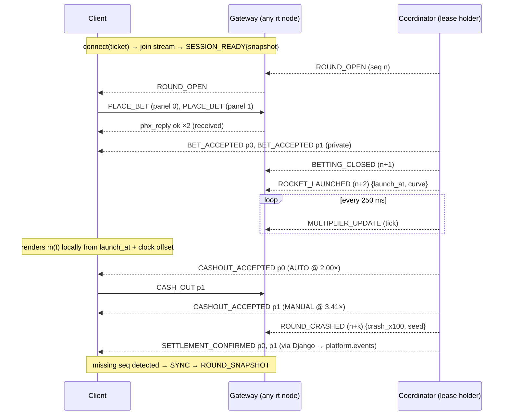

# 10 — WebSocket Protocol (Browser ⇄ Phoenix)

> Protocol name `lr.v1`. Illustrative, proposed contract. Source of truth will be `/contracts/ws/v1/*.schema.json`, from which `packages/protocol` TypeScript types and Elixir validators are generated.

## 1. Transport

- `wss://rt.luxrocket.example/socket/websocket?vsn=2.0.0&ticket=<ws_ticket>` (Phoenix Socket v2 JSON serializer for v1; a binary serializer is a later optimisation).
- `ws_ticket`: single-use, 30 s, from `POST /game/v1/ws-tickets` (HTTPS, Bearer game-session token). Burned on connect. The long-lived session token never appears in the WS URL (access logs record query strings).
- Reverse proxy strips query strings from access logs for `/socket/*` anyway (defence in depth).
- Heartbeat: Phoenix heartbeat 15 s; server closes sockets idle > 45 s.
- One socket per iframe; one channel join: `stream:{stream_id}`.

## 2. Connection lifecycle

1. Client obtains ticket → connects. Server consumes ticket via Django, receives claims `{sid, op, stream, currency, sv, exp}`; rejects on failure (`4401`).
2. Client joins `stream:{stream_id}` with `{protocol: "lr.v1", client_version, last_seq?}`. Join reply = `SESSION_READY` payload (includes a `ROUND_SNAPSHOT`).
3. Server pushes events; client sends commands.
4. Before game-session token expiry the client renews over HTTPS; the socket stays up as long as Django's session status remains ACTIVE (checked on join and every 60 s, plus pushed revocations).
5. On disconnect: exponential backoff with jitter (0.5, 1, 2, 4, 8 s, cap 10 s); new ticket each attempt; rejoin with `last_seq`.

## 3. Envelopes

Phoenix frames are `[join_ref, ref, topic, event, payload]`. `event` carries the message type below. Payload envelopes:

**Server event**
```json
{
  "type": "ROUND_OPEN",
  "v": 1,
  "stream_id": "str_global_main",
  "round_id": "rnd_01J9…",
  "seq": 418233,
  "server_ts": 1791633600123,
  "data": { }
}
```
- `seq`: per-stream, strictly increasing for public events (`stream_seq` of the journal entry or a tick counter in a separate space — ticks carry `tick_seq`, not `seq`, and gaps in ticks are ignored).
- Private events (on the session) carry `pseq`: per-session increasing counter, plus the related `round_id`/`bet_id`.

**Client command**
```json
{ "type": "PLACE_BET", "v": 1, "command_id": "0192f5c2-…(uuidv7)", "round_id": "rnd_…", "data": { } }
```
Phoenix reply (`phx_reply`) to a command means only **"received and stamped"**: `{status: "ok", response: {command_id, received_at}}` or `{status: "error", response: {code}}` for envelope/rate errors. Business results always arrive as separate events.

## 4. Messages

### 4.1 Server → client (public, `stream:{id}`)

| Type | When | `data` |
|------|------|--------|
| `ROUND_OPEN` | Betting opens | `opens_at, close_at, launch_at, commitment, ruleset_id, number` |
| `BETTING_CLOSED` | Cut-off | `close_at, launch_at` |
| `ROCKET_LAUNCHED` | Flight starts | `launch_at, curve: {kind: "exp", lambda_per_ms, table_hash}` |
| `MULTIPLIER_UPDATE` | 4 Hz during flight | `tick_seq, elapsed_ms, multiplier_x100` |
| `ROUND_CRASHED` | Round ends | `crash_x100, crash_at, end_reason: "CRASH"\|"MAX_MULTIPLIER", seed, salt, chain_id, chain_index` |
| `ROUND_VOIDED` | Malfunction/maintenance | `reason, seed` |
| `ROUND_STATS` | 1 Hz | `players_online, bets_count, cashed_count` (aggregates only) |
| `CASHOUT_FEED` | ≤ 2 Hz batched | recent cash-outs on this stream: `[{alias_masked, cashout_x100, panel}]` — **no amounts by default** (OQ-24) |
| `STREAM_NOTICE` | Maintenance etc. | `kind, message_key, starts_at` |
| `RESYNC_REQUIRED` | Server detects client gap or coordinator change | `reason` |

`PLANET_REACHED` from the brief is **not** a wire event: the client derives milestones from the multiplier and a versioned journey map (doc 14), saving fan-out and keeping one source of truth (the curve).

### 4.2 Server → client (private, session)

| Type | `data` |
|------|--------|
| `SESSION_READY` | `session: {sid_suffix, currency, exponent, locale, panels, limits: {min_stake, max_stake, max_win}, rg: {reminder_minutes}}`, `snapshot: ROUND_SNAPSHOT`, `server_ts` |
| `ROUND_SNAPSHOT` | §5 |
| `BET_ACCEPTED` | `command_id, bet_id, panel, stake, auto_cashout_x100` |
| `BET_REJECTED` | `command_id, panel, code, refund: "NONE"\|"PENDING"` |
| `CASHOUT_ACCEPTED` | `command_id?` (absent for auto), `bet_id, panel, cashout_x100, payout, trigger: "MANUAL"\|"AUTO"\|"MAX_WIN"\|"MAX_MULTIPLIER"` |
| `CASHOUT_REJECTED` | `command_id, bet_id, code` |
| `BET_LOST` | `bet_id, panel, crash_x100` |
| `SETTLEMENT_PENDING` | `bet_id, kind: "CREDIT"\|"REFUND", amount` (sent if not confirmed within 3 s) |
| `SETTLEMENT_CONFIRMED` | `bet_id, kind, amount, balance?` |
| `BALANCE_UPDATED` | `balance` (only if operator returns balances) |
| `SESSION_REVOKED` | `reason` — socket closes after send |
| `SESSION_REMINDER` | `elapsed_minutes` (RG) |
| `ERROR` | `code, retryable` |

### 4.3 Client → server

| Type | `data` | Valid when |
|------|--------|-----------|
| `PLACE_BET` | `panel, stake (string minor units), auto_cashout_x100?` | `BETTING_OPEN` |
| `CASH_OUT` | `bet_id` | `FLYING` |
| `SYNC` | `last_seq` | Any; server replies with `ROUND_SNAPSHOT` |
| `TIME_PING` | `client_ts` | Any; reply `{client_ts, server_ts}` for clock offset |

(`CANCEL_BET` is reserved; not in v1 — OQ-20.)

## 5. `ROUND_SNAPSHOT` schema (abridged JSON Schema)

```json
{
  "$id": "https://contracts.luxrocket.example/ws/v1/round-snapshot.json",
  "type": "object",
  "required": ["stream_id", "seq", "server_ts", "round"],
  "properties": {
    "stream_id": { "type": "string" },
    "seq": { "type": "integer" },
    "server_ts": { "type": "integer" },
    "round": {
      "type": "object",
      "required": ["round_id", "state", "number"],
      "properties": {
        "round_id": { "type": "string" },
        "number": { "type": "integer" },
        "state": { "enum": ["PENDING", "BETTING_OPEN", "BETTING_CLOSED", "FLYING", "CRASHED", "VOIDED"] },
        "opens_at": { "type": "integer" }, "close_at": { "type": "integer" }, "launch_at": { "type": "integer" },
        "commitment": { "type": "string" },
        "curve": { "type": "object" },
        "crash_x100": { "type": "integer", "description": "Present ONLY when state is CRASHED" },
        "seed": { "type": "string", "description": "Present ONLY when state is CRASHED or VOIDED" }
      }
    },
    "player_bets": {
      "type": "array",
      "items": {
        "type": "object",
        "required": ["panel", "status"],
        "properties": {
          "panel": { "type": "integer" }, "bet_id": { "type": "string" },
          "status": { "enum": ["PENDING", "ACCEPTED", "ACTIVE", "CASHED_OUT", "LOST", "REJECTED", "REFUND_PENDING", "REFUNDED"] },
          "stake": { "type": "string" }, "auto_cashout_x100": { "type": "integer" },
          "cashout_x100": { "type": "integer" }, "payout": { "type": "string" },
          "settlement": { "enum": ["NONE", "PENDING", "CONFIRMED"] }
        }
      }
    },
    "recent_crashes": { "type": "array", "items": { "type": "integer" }, "maxItems": 30 }
  }
}
```

### 5.1 Command schemas (abridged)
```json
{ "$id": "…/ws/v1/place-bet.json", "type": "object", "required": ["type","v","command_id","round_id","data"],
  "properties": { "type": {"const":"PLACE_BET"}, "v": {"const":1},
    "command_id": {"type":"string","format":"uuid"}, "round_id": {"type":"string"},
    "data": {"type":"object","required":["panel","stake"],"additionalProperties":false,
      "properties": {"panel":{"type":"integer","minimum":0,"maximum":7},
                     "stake":{"type":"string","pattern":"^[1-9][0-9]{0,17}$"},
                     "auto_cashout_x100":{"type":"integer","minimum":101}}}}}
```
```json
{ "$id": "…/ws/v1/cash-out.json", "type": "object", "required": ["type","v","command_id","round_id","data"],
  "properties": { "type": {"const":"CASH_OUT"}, "v": {"const":1},
    "command_id": {"type":"string","format":"uuid"}, "round_id": {"type":"string"},
    "data": {"type":"object","required":["bet_id"],"additionalProperties":false,
      "properties": {"bet_id":{"type":"string"}}}}}
```

## 6. Event flow



## 7. Timing, sequencing, recovery

- **Clock offset**: on join and every 30 s, 3 × `TIME_PING`; offset = median of `server_ts − (client_send + rtt/2)`; used only for rendering.
- **Gap detection**: if a public event arrives with `seq > last_seq + 1`, or a private event with `pseq` gap, client sends `SYNC` and renders from the snapshot. Duplicate/older seq are ignored (idempotent apply).
- **Visibility**: on `visibilitychange` → visible or after ≥ 2 s of missed heartbeats, client sends `SYNC` before rendering any flight (no "catch-up animation" of a flight it didn't see; jump to current state).
- **Coordinator change**: server emits `RESYNC_REQUIRED`; clients `SYNC`.
- **Pre-crash secrecy**: no pre-crash message contains `crash_x100`, `crash_at`, `seed` or anything derived from them; enforced by schema tests on every pre-crash event type and an Elixir compile-time struct split (`PublicRound` has no crash fields).
- **Client timestamps** are never used for deadlines; `TIME_PING.client_ts` is echoed only.

## 8. Error codes (closed enum, `lr.v1`)

| Code | Retryable | Meaning |
|------|-----------|---------|
| `BETTING_CLOSED` | No | Too late for this round |
| `ROUND_MISMATCH` | No | `round_id` not current |
| `PANEL_BUSY` | No | Panel already has a bet this round |
| `STAKE_OUT_OF_RANGE`, `AUTO_CASHOUT_INVALID`, `CURRENCY_MISMATCH` | No | Validation |
| `INSUFFICIENT_FUNDS`, `PLAYER_RESTRICTED`, `LIMIT_EXCEEDED`, `EXPOSURE_LIMIT` | No | Operator/business |
| `OPERATOR_UNAVAILABLE`, `OPERATOR_BUSY`, `SERVICE_UNAVAILABLE` | Yes (next round) | Dependency |
| `UNCERTAIN` | No | Debit outcome unknown; refund pending |
| `LATE` | No | Debit confirmed after launch; refund pending |
| `ROUND_ENDED` | No | Cash-out after crash |
| `NOT_ACTIVE`, `ALREADY_CASHED_OUT`, `NOT_OWNER` | No | Cash-out invalid |
| `COORDINATOR_UNAVAILABLE` | Yes (immediately, ≤ 2 tries) | Lease handover |
| `RATE_LIMITED` | Yes (after delay) | > 10 commands/s per socket |
| `PROTOCOL_ERROR` | No | Schema violation |

Close codes: `4401` auth failed, `4403` session revoked, `4408` ticket expired, `4429` too many connections, `4500` server draining (reconnect immediately elsewhere).

## 9. HTTPS vs WebSocket summary

| Over HTTPS (Django) | Over WebSocket (Phoenix) |
|---------------------|--------------------------|
| Launch token exchange, session renewal, WS ticket, config, rules, bet history, round verification, recent rounds (cold start) | `PLACE_BET`, `CASH_OUT`, `SYNC`, `TIME_PING`; all live round, bet, cash-out and settlement events |
