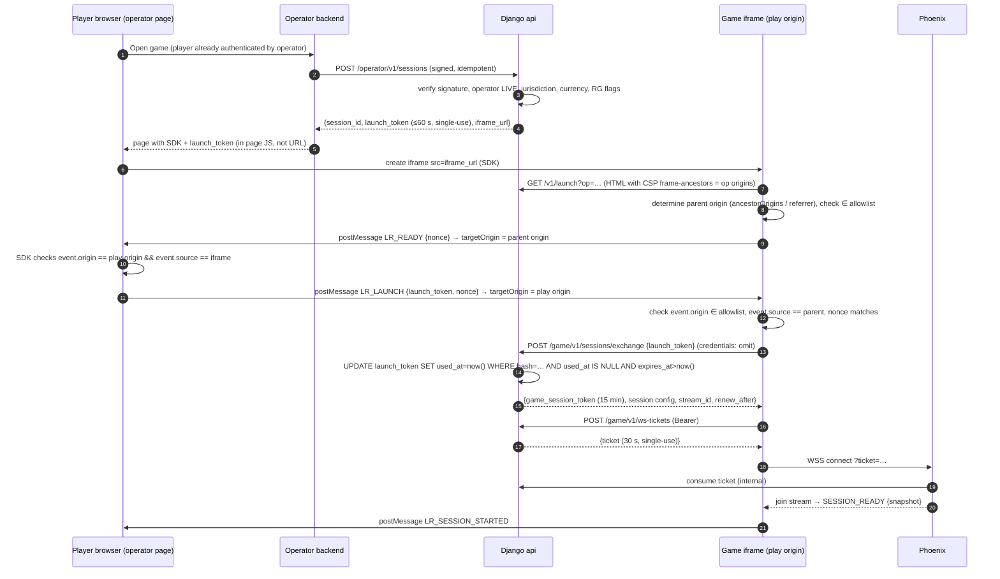

# 11 — Iframe and Embedding

## 1. Origins

| Origin | Serves | Notes |
|--------|--------|-------|
| `https://play.luxrocket.example` | Launch document (`/v1/launch`), SDK (`/sdk/v1/luxrocket-embed.js`) | Launch HTML is **dynamic** (per-operator CSP); everything else static |
| `https://assets.luxrocket.example` | Versioned JS/CSS/3D assets (CDN, immutable, content-hashed) | `Cross-Origin-Resource-Policy: cross-origin`, long cache |
| `https://api.luxrocket.example` | Game HTTP API | CORS allow-origin: exactly the play origin |
| `wss://rt.luxrocket.example` | WebSocket | `check_origin`: exactly the play origin |

**Why the launch document is dynamic.** `frame-ancestors` must list *this operator's* origins and must be on the HTML response. A pure static export on a CDN cannot vary it per operator. The launch route is a tiny HTML shell rendered by `django-api` (or a CDN edge function fed by Django) from a cached per-operator allowlist (60 s TTL; immediate bust on domain change). All application JS remains static on the CDN.

## 2. Canonical URL

```
https://play.luxrocket.example/v1/launch?op=<operator_public_id>&lang=<bcp47>[&gv=<game_version>]
```
- No tokens, player ids, currencies or balances in the URL.
- `gv` only honoured if the operator is enrolled in that version's rollout.
- Fallback mode adds a fragment: `#lt=<launch_token>` (never sent to servers; cleared immediately with `history.replaceState`).

## 3. Launch-session sequence (postMessage handshake — primary)



### 3.1 Fallback (fragment) mode
For WebViews and integrations that cannot run the SDK: the operator navigates/iframes `fragment_launch_url`. The game reads `location.hash`, immediately `history.replaceState` to drop it, then exchanges the token. Risks accepted: token briefly in browser history/memory of the WebView; mitigated by ≤ 60 s TTL and single use. Query-string tokens are **never** accepted.

### 3.2 Optional hardening (Phase G): sender-constrained tokens
At exchange, the iframe generates a non-extractable WebCrypto P-256 key pair and sends the public JWK; the game-session token is bound to it (`cnf.jkt`) and every Game API call carries a DPoP-style proof (RFC 9449). A stolen bearer token alone becomes useless. Deferred because it adds client complexity; recommended before real-money launch (OQ-25).

## 4. Token & session rules

| Credential | TTL | Storage (browser) | Single-use | Revocation |
|-----------|-----|-------------------|-----------|------------|
| Launch token | ≤ 60 s | SDK memory / fragment (cleared) | Yes (Postgres conditional update) | Expires |
| Game-session token | 15 min, renew at 80 % | JS memory only (no localStorage/cookies) | No | `session_version` bump ⇒ rejected within ≤ 5 s |
| WS ticket | 30 s | JS memory | Yes | Expires |
| Session | ≤ 24 h absolute or operator limit | — | — | Operator API, platform admin, RG time limit |

- Replay: launch token hash looked up and consumed atomically; second use ⇒ `401 TOKEN_USED` + security audit event (possible theft).
- Renewal: `POST /game/v1/sessions/renew` with the current token; denied if session revoked/expired; returns new token with same `sid`.
- Reconnect: new WS ticket each attempt (requires a valid game-session token).
- Reload inside the iframe loses memory ⇒ game shows "Session ended" and posts `LR_RELAUNCH_REQUIRED`; the SDK invokes the operator's `onRelaunchRequired` callback, which obtains a fresh launch token from the operator backend. No third-party cookie is involved.
- Operator invalidation: `POST /operator/v1/sessions/{id}/revoke` ⇒ DB status + `session.revoked` event ⇒ socket closed (`4403`) ⇒ `LR_SESSION_REVOKED` to parent.

## 5. Parent-frame message contract (`lr: 1`)

All messages: `{ "lr": 1, "type": "...", "nonce": "...", "data": {...} }`. Unknown types ignored; schema-validated on both sides; every receiver checks `event.origin` against an exact allowlist **and** `event.source` identity. `targetOrigin` is never `"*"` for any message that carries data.

| Direction | Type | Data |
|-----------|------|------|
| iframe → parent | `LR_READY` | `nonce, protocol_versions: [1]` |
| parent → iframe | `LR_LAUNCH` | `launch_token, nonce` |
| iframe → parent | `LR_SESSION_STARTED` | `session_id` |
| iframe → parent | `LR_BALANCE_HINT` | none — tells the operator to refresh its own balance display |
| iframe → parent | `LR_RESIZE` | `height` (for non-fixed layouts) |
| iframe → parent | `LR_FULLSCREEN_REQUEST` | — (SDK expands iframe to fixed overlay where Fullscreen API is unavailable, e.g. iPhone Safari) |
| iframe → parent | `LR_RELAUNCH_REQUIRED` | `reason` |
| iframe → parent | `LR_SESSION_REVOKED` | `reason` |
| iframe → parent | `LR_EXIT` | — (player pressed "Back to lobby") |
| iframe → parent | `LR_ERROR` | `code` |
| parent → iframe | `LR_SET_AUDIO` | `muted: bool` |
| parent → iframe | `LR_CLOSE` | — (iframe ends socket cleanly) |

## 6. Content Security Policy (launch document)

```
Content-Security-Policy:
  default-src 'none';
  script-src 'self' https://assets.luxrocket.example 'sha256-<build-time hashes>';
  style-src 'self' https://assets.luxrocket.example;
  img-src 'self' https://assets.luxrocket.example data: blob:;
  font-src https://assets.luxrocket.example;
  connect-src https://api.luxrocket.example wss://rt.luxrocket.example https://assets.luxrocket.example;
  worker-src 'self' blob:;
  media-src https://assets.luxrocket.example;
  frame-ancestors https://www.operator-a.example https://m.operator-a.example;
  base-uri 'none'; form-action 'none'; object-src 'none';
  upgrade-insecure-requests;
  report-to csp
Referrer-Policy: no-referrer
Permissions-Policy: camera=(), microphone=(), geolocation=(), payment=(), usb=()
Cross-Origin-Opener-Policy: same-origin-allow-popups
X-Content-Type-Options: nosniff
Strict-Transport-Security: max-age=63072000; includeSubDomains; preload
```
- **No `X-Frame-Options`** on the launch document (it would block legitimate embedding); `frame-ancestors` governs framing. All non-embeddable surfaces (admin, portal, API docs) send `frame-ancestors 'none'` + `X-Frame-Options: DENY`.
- Operator origins are exact `scheme://host[:port]`; no wildcards in production (sandbox may allow `http://localhost:*` for the operator's dev).
- CSP violation reports collected per operator to detect mis-embedding.

Recommended operator iframe markup (SDK generates it):
```html
<iframe src="https://play.luxrocket.example/v1/launch?op=op_…&lang=en"
        allow="fullscreen; autoplay"
        sandbox="allow-scripts allow-same-origin"
        referrerpolicy="origin"
        title="LUX ROCKET"
        style="width:100%;height:100%;border:0"></iframe>
```
`referrerpolicy="origin"` lets the game determine the parent origin in browsers without `location.ancestorOrigins`.

## 7. Responsive & device behaviour

| Context | Layout |
|---------|--------|
| Portrait phone (≥ 320 × 480) | Scene top ~55 %, multiplier overlaid; two panels stacked/tabbed below |
| Landscape phone | Scene left ~65 %, panels right column |
| Tablet / desktop | Scene centre, panels bottom side-by-side, history strip top |
- Layout is driven by **container size**, not viewport (iframe may be any size); container queries.
- Minimum supported iframe: 320 × 480; below that a "Rotate or enlarge" message.
- Orientation changes do not reload; scene resizes; canvas DPR capped (doc 14).
- Safe-area insets respected in fullscreen overlay.

## 8. Browser support (initial)

| Tier | Browsers |
|------|----------|
| Supported | Chrome/Android WebView last 3 major, Samsung Internet last 2, Safari iOS 15+, Firefox last 2, Edge last 2, Opera (Chromium) |
| Degraded | No WebGL ⇒ 2D fallback scene (CSS/Canvas2D) — gameplay unaffected |
| Unsupported | Opera Mini extreme mode, IE ⇒ static "unsupported browser" page |

## 9. Error, maintenance and network states

| State | Trigger | UI | Parent message |
|-------|---------|----|----------------|
| Launch invalid/expired | exchange 401 | "Session expired — reopen the game" | `LR_RELAUNCH_REQUIRED` |
| Origin not allowed | parent not in allowlist | Blank safe screen (no token exchange attempted) | none |
| Reconnecting | socket down | Overlay "Reconnecting…", panels locked, active bets shown as "Pending result" | — |
| Offline > 30 s | — | "Connection lost. Your bets are safe; results will appear when you reconnect." | — |
| Maintenance | `STREAM_NOTICE` / `GAME_UNAVAILABLE` | Maintenance screen with time | `LR_ERROR{MAINTENANCE}` |
| Session revoked | `SESSION_REVOKED` | "Session ended by operator" | `LR_SESSION_REVOKED` |

## 10. Versioning
- `/v1/launch`, SDK `/sdk/v1/`, postMessage `lr: 1`, WS `lr.v1`. Breaking changes bump all relevant majors; old major kept ≥ 6 months.
- Game client versions are released per `GameVersion`; operators can be pinned or follow the stream default (controlled rollout, doc 12 §5.3).
- Operators never copy game source; they embed the SDK (SRI-hash published) or the iframe directly.
