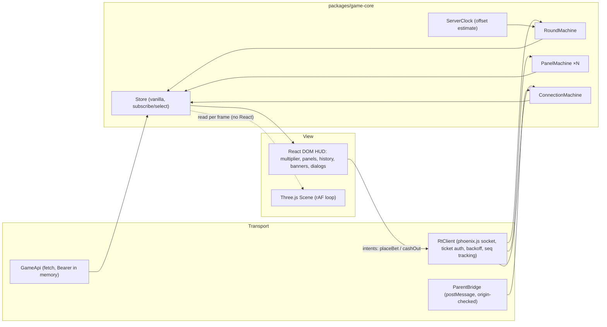

# 14 — Frontend and Game Rendering

## 1. Workspace

pnpm workspaces + Turborepo (ADR-001, ADR-017). TypeScript `strict: true`, `noUncheckedIndexedAccess`, `exactOptionalPropertyTypes`.

| Package | Purpose | Notes |
|---------|---------|-------|
| `apps/game` | Embedded player game | Next.js App Router, `output: 'export'`, served from CDN; no SSR, no server actions |
| `apps/admin` | Platform admin | Next.js App Router; authenticated shells; data via TanStack Query to same-origin `/api/admin/v1` |
| `apps/portal` | Operator portal | Same stack as admin; separate design density defaults |
| `packages/ui` | shadcn/ui components (copied & owned), Tailwind preset, design tokens (CSS variables) | Two themes: `game` (cinematic) and `console` (dense enterprise) |
| `packages/protocol` | Generated TS types + runtime validators for WS & Game API (from `/contracts`) | Validators tree-shaken; game validates inbound frames in dev, sampled in prod |
| `packages/sdk` | Operator embed SDK | Framework-free, ≤ 3 KB gz, published with SRI |
| `packages/game-core` | Framework-agnostic game state machines (round, panels, connection, clock) | Pure TS, no DOM — unit/model tested |
| `packages/scene` | Three.js scene, journey map, quality manager | Imperative; no React inside the render loop |

## 2. Game app architecture

- **Single source of truth**: `game-core` machines driven only by server events + user intents. React renders from selectors; the scene reads the store each frame.
- **Machines** are hand-written typed reducers with exhaustive `switch` (no FSM library, to protect bundle size). Panel machine = doc 08 §1.1.
- **Per-frame values** (multiplier text, potential return) are written by a rAF callback directly to DOM nodes via refs — not React state — to avoid 60 re-renders/s on low-end devices.

### 2.1 Component boundaries (HUD)
`GameShell` › `TopBar` (history strip, rules, verify, sound, fullscreen) › `Stage` (`SceneCanvas` + `MultiplierDisplay` + `RoundStatus` + `MilestoneToast`) › `PanelDeck` (`BetPanel index=0`, `BetPanel index=1`; deck renders `config.panels` panels) › `ConnectionBanner` › dialogs (`RulesDialog`, `VerifyDialog`, `MyBetsDialog`, `SessionReminderDialog`).

`BetPanel` subcomponents: `StakeInput` (string minor units internally; formatted with currency exponent), `QuickStakes`, `AutoCashoutField`, `PrimaryActionButton` (BET / CANCEL-queued / WAITING / CASH OUT {amount} / CASHED {x}), `PanelStatusLine`.

## 3. Multiplier display rules

1. Before launch: shows countdown to `launch_at`.
2. In flight: `m_display(t) = floor10000(exp(λ · (now_server_est − launch_at)))`, where `now_server_est = Date.now() + offset`.
3. `MULTIPLIER_UPDATE` corrections: if |local − server| > 2 %, re-estimate offset (smoothly).
4. `ROUND_CRASHED`: snap to `crash_x10000`, play crash. A display overshoot of up to one network RTT is possible (typically ≤ 0.05× at moderate multipliers); the crash value shown is authoritative.
5. The "CASH OUT {amount}" label is an estimate; the confirmation shows the server's multiplier and payout.
6. Never interpolate *past* a missing `ROUND_CRASHED` for more than 3 s without any server message: freeze with "Waiting for server…" and `SYNC`.

## 4. Three.js scene

### 4.1 Journey map (presentation only, versioned with the client)
Path parameter `u = ln(m) / ln(M)` ∈ [0, 1] maps the rocket along a spline through zones. Zone thresholds in multiplier (doc 07 §5.2):

| Zone | Enters at | Visuals | Distance label (simulated, not to scale) |
|------|----------:|---------|-----------------------------------------|
| Launchpad & atmosphere | 1.00× | Pad, clouds, sky gradient, Earth surface | — |
| Earth orbit | 1.20× | Curvature, aurora, ISS-like silhouette (original design) | "400 km" |
| Moon | 2× | Moon flyby | "≈ 1.3 light-seconds" |
| Mars | 5× | Red planet, Phobos | "≈ 3–22 light-minutes" (real range) |
| Jupiter | 20× | Banded giant, moons | "≈ 33–54 light-minutes" |
| Saturn | 50× | Rings | "≈ 1.1–1.5 light-hours" |
| Deep space | 100× | Nebula skybox, starfield parallax | "Outer solar system" |
| Heliopause | 1 000× | Particle boundary effect | "≈ 16–17 light-hours" |
| Journey complete (cap) | M | Proxima Centauri glow | "4.24 light-years — nearest star" |

Rules: labels state *real* distances from Earth/Sun with "simulated journey" disclosure; a light-year is presented as a distance. Milestone toasts are neutral ("Passing Mars") and are never rewards. **No near-miss dramatisation**: a crash just before a planet is rendered identically to any other crash.

### 4.2 Scene inventory
| Element | Technique | Low tier | High tier |
|---------|-----------|----------|-----------|
| Rocket | glTF (meshopt), PBR, ≤ 15 k tris | ≤ 5 k tris, baked lighting | full PBR + emissive |
| Exhaust | GPU instanced sprites, additive | 200 particles | 2 000 + heat distortion |
| Earth | Sphere + KTX2 albedo + atmosphere shader | 1 k texture, no clouds layer | 2–4 k, clouds, night lights |
| Moon/Mars/Jupiter/Saturn | Spheres + KTX2; Saturn ring as textured disc | 512–1 k | 2 k |
| Starfield | `Points` instanced, procedural | 2 k stars | 20 k + parallax layers |
| Skybox | Low-res cubemap/equirect KTX2 | 512 | 2 k |
| Crash explosion | Instanced burst + flash | simplified | full + camera shake |
| Post-processing | Bloom (selective) | off | on |

### 4.3 Camera & motion
Follow camera with critically-damped spring behind/beside the rocket; zone transitions are camera dolly + FOV ease over 600–900 ms; never cut during cash-out-critical moments (no occlusion of HUD). Reduced-motion: no shake, no FOV kicks, cross-fades instead of dollies, particle counts halved.

### 4.4 Quality management
- Initial tier from heuristics (`navigator.deviceMemory`, `hardwareConcurrency`, WebGL renderer string allow/deny list, screen size), then **measured**: first 120 frames' p90 frame time → adjust.
- Runtime governor: if p90 > 33 ms for 2 s ⇒ step down (DPR, particles, post-processing); step up only between rounds.
- DPR cap: low 1.0, medium 1.5, high 2.0. Canvas sized to container.
- `powerPreference: 'low-power'` on low tier; antialias off on low (FXAA on medium).
- Context loss handled: rebuild scene, HUD keeps working.
- No WebGL ⇒ `Canvas2DScene` fallback (2D rocket + curve), gameplay identical.

### 4.5 Asset loading
| Stage | Content | Budget (gz/compressed) |
|-------|---------|------------------------|
| 0 Shell | HTML, CSS, HUD JS, fonts subset | ≤ 150 KB JS, ≤ 60 KB CSS+fonts |
| 1 Playable | Three.js chunk, rocket low LOD, Earth low, skybox low | ≤ 1.5 MB total |
| 2 Background | Remaining zones low tier, sounds | ≤ 3 MB, loaded during betting phases / idle |
| 3 Enhancement | High-tier textures (only on high tier, on Wi-Fi heuristic via `navigator.connection` where available) | as needed |
- **HUD is interactive at stage 0**: players can bet before the 3D scene finishes loading (scene shows a lightweight placeholder).
- All assets content-hashed, immutable, CDN; KTX2 (Basis) textures; meshopt geometry; Draco only if measured better.
- Asset manifest versioned with `GameVersion`.

### 4.6 Suspension, reconnection, falling behind
- Tab hidden ⇒ rAF stops naturally; on visible ⇒ `SYNC`, jump to state (no replay).
- Renderer behind the authoritative state (slow frames) ⇒ the scene always samples "now"; it never queues frames. The multiplier text and panel buttons are independent of scene frame rate.
- Reconnect ⇒ panels show `RECOVERING` until snapshot; snapshot's `player_bets` are authoritative.

## 5. PixiJS
Not in v1 (ADR-018). Criteria to introduce: a 2D overlay need that (a) DOM/CSS can't hold at ≥ 30 fps on the reference device and (b) can't be done in the existing Three.js context. If introduced, it must share the WebGL context approach or be justified with memory measurements.

## 6. Accessibility (game)
- All controls are native buttons/inputs, keyboard operable; visible focus.
- `aria-live="polite"`: round state changes (betting open/closed, launched, crashed at X). `aria-live="assertive"`: own bet accepted/rejected, cashed out at X for amount.
- Multiplier element `aria-hidden` during flight (too chatty); a "Read multiplier" shortcut announces current value.
- Contrast ≥ 4.5:1 for text over scene (scrim behind HUD).
- Reduced motion honoured (`prefers-reduced-motion` + toggle). Sound off by default; captions for sound cues not needed (no speech).
- Large touch targets (≥ 48 px) for BET/CASH OUT; CASH OUT placed where thumbs rest; no gesture-only actions.

## 7. Admin & portal frontends
- App Router; route groups per module; server components only for static shells, data fetched client-side with TanStack Query (cookies are host-only to the API path; SSR fetching with forwarded cookies avoided for simplicity and CSRF clarity).
- Tables: TanStack Table with server-side pagination/filtering; forms: react-hook-form + zod schemas generated from OpenAPI.
- Charts: one library chosen in Phase F (candidates ECharts, Recharts), consistent palette from `packages/ui`.
- Strict CSP with nonces (SSR) and `frame-ancestors 'none'`.

## 8. Performance test matrix (frontend)
Reference devices (to procure/emulate): low (2–3 GB RAM, Mali-G52/Adreno 6xx class Android Go/entry), mid (4 GB, Adreno 610 class), iPhone SE 2nd gen, desktop. Network profiles: Fast 3G, Slow 4G, 4G with 2 % loss. Metrics: TTI, time-to-first-bet-possible, fps p50/p90 per tier, memory, bytes transferred per round session hour. Budgets in NFR-008.
