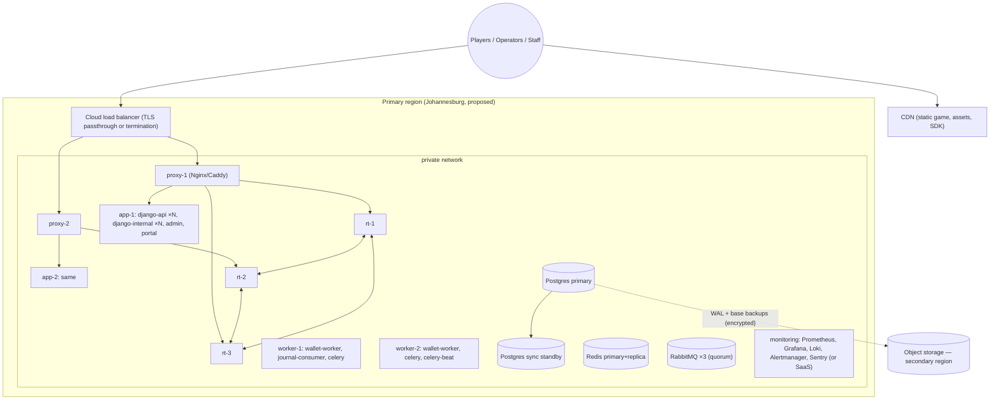

# 17 — Deployment and Observability

## 1. Environments

| Env | Purpose | Data | Topology |
|-----|---------|------|----------|
| local | Development | Synthetic | Docker Compose single host |
| ci | Automated tests | Ephemeral | Compose |
| staging | Pre-release, load & chaos | Synthetic | Production-like (smaller hosts) |
| sandbox | Operator integration | Virtual credits | Production-like, separate DB, separate keys |
| production | Real play | Real | §2 |

Sandbox and production share **no** databases, queues, secrets or signing keys.

## 2. Production topology (reference)

- Hosts: Linux (Ubuntu LTS or Debian stable), Docker Engine, each service as a container; deploy via Kamal or Ansible + Compose (decision at scaffold time, OQ-30). Zero-downtime rolling deploys host by host.
- Phoenix nodes form an Erlang cluster over the private network (libcluster DNS/static); distribution over TLS; EPMD-less fixed ports.
- Admin & portal may sit behind an additional IP allowlist / VPN (OQ-26).
- Managed Postgres preferred (sync standby, PITR) if available in-region with acceptable latency; otherwise Patroni + etcd on 3 small VMs (adds ops load — documented as a risk).

## 3. Container images
- Multi-stage builds; distroless/slim runtime images; non-root; read-only root FS; health checks.
- `backend` image (one image, different commands per process type), `realtime` image (Elixir release), `admin`, `portal` images; `game` is a static artefact uploaded to CDN with immutable hashes.
- Images signed (cosign) and SBOM attached; deploy verifies signatures.

## 4. Secrets
| Secret | Where | Rotation |
|--------|-------|----------|
| DB role passwords | secret files / manager | 90 days |
| Platform signing keys (Ed25519) | secret manager / HSM (OQ-06) | Yearly, `kid` overlap 30 days |
| Game-session token signing key | secret manager | 90 days, overlap = token TTL |
| Field-encryption KEK | KMS/HSM or sealed file on app hosts | Yearly; DEK rewrap job |
| Seed-chain KEK | Separate from field KEK; only rt hosts can unwrap | Per chain |
| mTLS certs (internal CA) | Issued per service | 90 days (automated) |
| RabbitMQ/Redis creds | secret files | 90 days |
Runbooks: credential rotation per secret, including emergency revocation.

## 5. Observability

### 5.1 Signals
- **Metrics**: Prometheus (Django via `django-prometheus` + custom; Phoenix via PromEx/telemetry; Postgres/Redis/RabbitMQ exporters; node exporter; blackbox probes; frontend RUM beacons aggregated server-side).
- **Logs**: structured JSON to Loki (or equivalent); fields: `ts, level, service, env, correlation_id, operator_id, session_id (hashed), round_id, bet_id, event`. Redaction allowlist (doc 15 §3).
- **Traces**: OpenTelemetry across game API → Django → wallet, and Phoenix → Django internal; trace id = correlation id propagated via `traceparent` and WS command `command_id` linkage.
- **Errors**: Sentry (self-hosted or SaaS — SaaS requires data-processing assessment) for Django, Phoenix, frontends with PII scrubbing.

### 5.2 Key metrics & initial alert proposals (tune after load tests)

| Area | Metric | Initial alert |
|------|--------|---------------|
| Django API | p95/p99 latency, 5xx rate per surface | p99 > 500 ms 5 min; 5xx > 1 % 5 min |
| Internal bet path | place-bet p99, rejection reasons | p99 > 1.2 s 5 min |
| Phoenix | sockets per node, join latency, command latency | command p99 > 50 ms; socket drop > 5 %/min |
| Fan-out | broadcast→push latency | p95 > 250 ms |
| Coordinator | lease renew failures, mailbox length, round transitions late | any renew failure; mailbox > 1 000; transition > 100 ms late |
| Rounds | void count, round cycle duration | any void (page); cycle outside ±1 s of expected |
| Journal | flush latency, relay lag | flush p99 > 20 ms; relay lag > 5 s |
| Postgres | replication lag, connections, locks, slow queries | sync standby lost; connections > 80 % |
| Redis | latency, memory | p99 > 5 ms |
| RabbitMQ | queue depth, unacked, DLQ size | DLQ > 0; depth growing 10 min |
| Wallet | success rate, latency per operator, breaker state | success < 99 % 10 min; breaker open |
| Settlement | `payouts_payable` oldest age, credits in retry | > 15 min (warn), > 1 h (page) |
| Duplicates | idempotent replays, constraint hits | spike vs baseline (signal, not page) |
| Reconciliation | open discrepancies by severity | any high severity |
| Clock | node offset | > 5 ms (remove from LB) |
| Frontend | fps per tier, asset load time, JS errors, reconnect rate | error rate > 2 % sessions |

SLOs are proposals (NFR-006) and reported only once measurement exists.

## 6. Backups & recovery

| Item | Policy |
|------|--------|
| Postgres | Continuous WAL archiving + daily base backups to object storage in another region; encrypted; PITR 35 days; monthly snapshots 13 months; yearly 7 years (financial) |
| RPO | 0 for committed transactions within region (sync standby); ≤ 5 min for regional loss (WAL archive interval) |
| RTO | ≤ 30 min for primary failover; ≤ 4 h for full-region rebuild from IaC + backups (proposal) |
| Restore tests | Monthly automated restore to scratch env + invariant checks; quarterly DR game-day |
| RabbitMQ | Not backed up (reconstructible); definitions exported in git |
| Redis | Not backed up |
| Config/IaC | Git |
| Seed chains | Encrypted root + checkpoints in DB backups; ceremony artefacts (sealed) in two offline locations |

Regional-loss note: rounds in flight are voided (ADR-005); credits/rollbacks resume from the restored DB; any wallet operations performed after the last archived WAL are recovered via operator reconciliation (transaction ids are deterministic, so replays are safe).

## 7. Release & rollback
- Trunk-based; `main` protected; CI green required; conventional commits.
- Backend/realtime: rolling deploy; DB migrations **expand → migrate → contract** across releases; no destructive migration in the same release as code depending on it.
- Phoenix deploy: node drain (`SERVER_DRAINING`), coordinator hands over **at round boundary**, sockets migrate.
- Game client: new `GameVersion` assets uploaded; streams/operators switched by config; rollback = re-point to previous approved version (assets immutable).
- Ruleset changes follow the approval workflow and apply at a round boundary.
- Feature flags for non-math UI features only; never for outcome or money logic.

## 8. Incident response
Severity matrix (SEV1: money correctness/outcome integrity or full outage; SEV2: partial outage/one operator; SEV3: degraded). On-call rotation, runbooks per alert, status page for operators, operator notification webhooks, post-incident review within 5 business days. SEV1 includes: any invariant violation, suspected seed exposure (⇒ revoke chain, start new ceremony, void remaining rounds of that chain), credential compromise.

## 9. Degradation behaviour
| Dependency down | Behaviour |
|-----------------|-----------|
| One operator's wallet | That operator's bets rejected (`OPERATOR_UNAVAILABLE`); credits queued |
| Django internal | No new bets; flights/cash-outs continue |
| RabbitMQ | Settlement delayed; gameplay continues |
| Redis | Slightly higher DB load; gameplay continues |
| Postgres | Gameplay stops (void + maintenance screen) — correctness over availability |
| CDN | Game unavailable for new loads; existing sessions continue |

## 10. Maintenance procedures
Scheduled maintenance announced ≥ 24 h ahead via webhook/portal; streams drained at round boundary; `STREAM_NOTICE` to players; post-maintenance smoke tests run first on staging, then on a production canary rt node observed for one full round cycle before the rest of the fleet. Whether a synthetic internal test operator may place real-money-stream test bets (e.g. minimum stake against an internal wallet) is a regulatory question — **OQ-31**.
