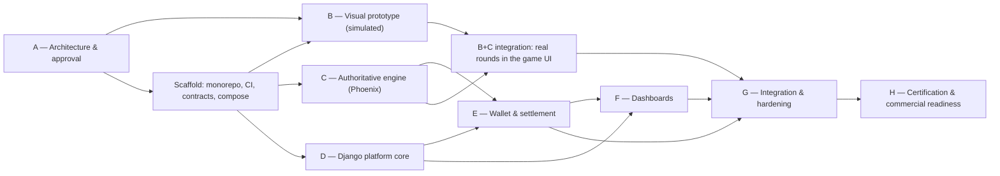

# 19 — Implementation Roadmap

No calendar dates are given: the repository is empty and team capacity is unknown (OQ-02). Sizes are relative (S ≈ 1–2 engineer-weeks, M ≈ 3–5, L ≈ 6–10) and are to be re-estimated once the team is known.

## 1. Dependency graph

## 2. Phases

### Phase A — Architecture & discovery (this package)
- Deliverables: docs 00–22. **Gate A**: approval of doc 22 + decisions on approval-critical OQs (doc 20 §1).

### Scaffold (precedes B/C/D; S)
- Monorepo layout (ADR-001), pnpm/Turborepo, Django project skeleton, Phoenix app skeleton, `/contracts` with first schemas, codegen pipeline, Docker Compose (Postgres, Redis, RabbitMQ), CI (lint, typecheck, tests, bundle budget), pre-commit secrets scanning, CODEOWNERS, branch protection.
- Acceptance: `make up` boots the stack; CI green on an empty feature; contract codegen produces TS/Elixir/Python artefacts.

### Phase B — Visual prototype (M–L)
- `game-core` machines, HUD, two panels, local **simulated** round engine (in-browser, using `LR-CRASH-1` with throwaway seeds), Three.js scene with Earth/launch + 2 zones, quality manager, reduced motion, virtual credits.
- Acceptance (AC-B): 30 fps low tier on reference device; usability test 4/5; bundle budgets met; no network dependency.
- Risk: art direction churn → time-box; procedural placeholders.

### Phase C — Authoritative engine (L)
- Phoenix: lease/fencing, coordinator `:gen_statem`, journal writer/relay, curve table, outcome module + seed-chain tooling (ceremony mix task), channels, protocol `lr.v1`, snapshots, ticks, auto cash-out, void recovery, drain handover.
- Stubbed Django internal bet endpoint (always-accept sandbox) to decouple from D.
- Acceptance (AC-C): property tests; kill/partition tests; 10⁸-outcome distribution test; S0 load.

### Phase D — Django platform core (L)
- Operators, credentials (Ed25519/HMAC), domains, config versions, limits; sessions, launch tokens, exchange, renewal, WS tickets; launch document with per-operator CSP; Game API; internal API; staff auth + MFA; audit chain; outbox relay; tenant context + RLS.
- Acceptance: signature/replay tests; launch handshake E2E from a foreign-origin test parent; cross-tenant suite for implemented endpoints.

### Phase E — Wallet & settlement (L)
- Seamless wallet adapter (aiohttp), bulkheads, breakers; wallet-worker; journal-consumer; ledger; settlements; reconciliation (internal); operator simulator with fault injection; conformance suite.
- Acceptance (AC-D/E): chaos suite with zero invariant violations; duplicate/timeout matrix (doc 08 §10) all green.

### Phase F — Dashboards (L)
- Admin modules (doc 12) and portal modules (doc 13); reporting aggregates; exports; approvals.
- Acceptance (AC-F): authz matrices; cross-tenant 100 %; report totals = ledger totals; WCAG AA.

### Phase G — Integration & hardening (M–L)
- Full-zone 3D content (assets per doc 18 §6), DPoP binding (if approved), performance tuning, S1/S2 load tests, DR game-day, pen-test, observability dashboards & runbooks, operator-facing docs & SDK publication.
- Acceptance (AC-G): S1 targets met; no open high/critical pen-test findings; restore test passed.

### Phase H — Certification & commercial readiness (externally paced)
- Independent math review, lab certification submission, jurisdiction licensing support, DPA templates, operator contracts, regulator reporting formats, first operator sandbox → production pilot (low limits).
- Acceptance (AC-H): certificate for at least one jurisdiction; real-money enablement checklist complete for pilot operator.

## 3. Milestones
| M | Milestone | Exit evidence |
|---|-----------|---------------|
| M0 | Architecture approved | Signed-off doc 22 |
| M1 | Stack boots, CI green | Scaffold acceptance |
| M2 | Playable prototype (simulated) | AC-B report |
| M3 | Shared authoritative rounds in the real UI (sandbox credits) | Multi-browser E2E same crash point |
| M4 | Operator sandbox integration end-to-end | Operator simulator passes conformance; settlement invariants hold |
| M5 | Dashboards MVP | AC-F |
| M6 | Hardened release candidate | AC-G |
| M7 | Certified pilot (real money, one operator, one jurisdiction) | AC-H |

## 4. Major risks
| ID | Risk | Impact | Mitigation |
|----|------|--------|-----------|
| R-01 | Licensing/certification path unclear or unavailable in target markets | Blocks revenue | Engage counsel & a lab during Phase B; design keeps RNG source swappable |
| R-02 | Operator wallet APIs slow/inconsistent | Bet failures, disputes | Conformance suite, custom adapters, rollback-on-doubt, per-operator isolation |
| R-03 | Two-runtime complexity (Django + Phoenix) for a small team | Velocity, incidents | Hard boundary (ADR-002/003), contracts-first, shared runbooks; revisit ADR-002 alternative if bet-path latency fails |
| R-04 | Low-end device performance | Player churn | HUD-first loading, quality governor, 2D fallback, device lab from Phase B |
| R-05 | Seed/insider risk | Catastrophic trust loss | Key management, four-eyes ceremonies, monitoring |
| R-06 | Hosting/data-residency constraints | Re-platforming | Resolve OQ-03/04 before Phase G |
| R-07 | Scope creep into player-facing features (chat, tournaments) | Delay | Non-goals list; change control via ADRs |

## 5. Approval gates
| Gate | Before | Requires |
|------|--------|----------|
| Gate A | Any code | Doc 22 approval; approval-critical OQs answered or defaults accepted |
| Gate B→C | Engine work on real rules | Ruleset defaults (OQ-14/17) accepted (OQ-13/18 decided) for development |
| Gate E | Any external operator sandbox | Security review of launch/session/wallet code |
| Gate RM (real money) | Per operator | Contract, licence evidence, lab certificate for the stream's ruleset, pen-test clear, DR test passed, approval_request four-eyes |
